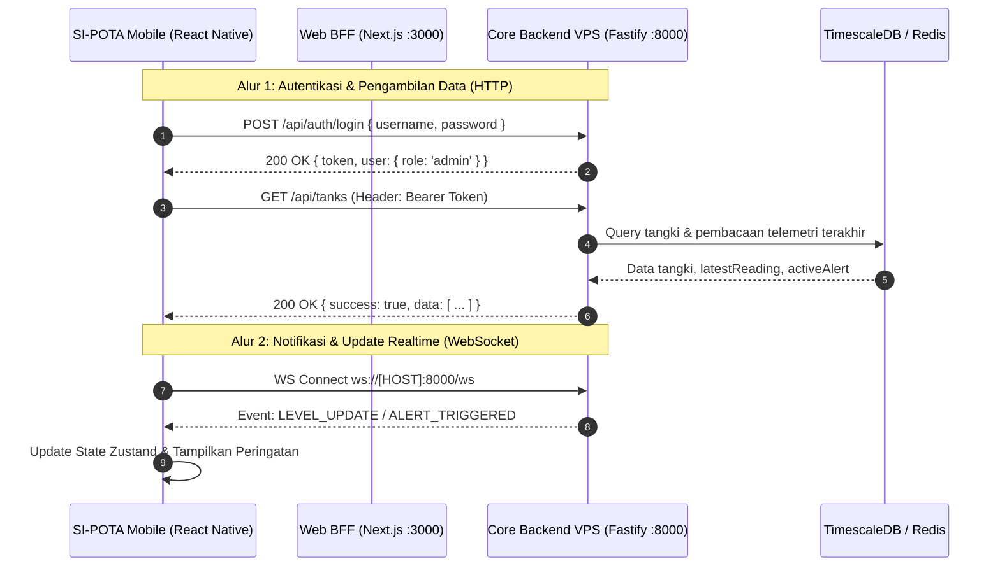

# 📱 SI-POTA Mobile v1.0 — Aplikasi Seluler Pemantauan Tangki Air (RSA UGM)

Selamat datang di repositori resmi **Aplikasi Seluler (Mobile App)** untuk proyek **Work Package 4 (WP-4): Sistem Informasi Pemantauan dan Pengendalian Level Air Berbasis IoT di Rumah Sakit Akademik (RSA) Universitas Gadjah Mada**.

Aplikasi ini dibangun menggunakan **React Native (Expo SDK 58)** dan dirancang khusus sebagai alat pemantauan saku (*pocket glance tool*) bagi staf fasilitas dan teknisi lapangan yang bermobilitas tinggi di lingkungan rumah sakit.

> **Dokumen Referensi Utama:**
> * Master Frontend PRD: [`docs/PRD-MFE.md`](docs/PRD-MFE.md)
> * Spesifikasi Teknis Mobile: [`docs/PRD-Mobile.md`](docs/PRD-Mobile.md)

---

## 📖 Gambaran Umum & Visi Produk

Petugas pemeliharaan fasilitas RSA UGM berpindah secara konstan antar-gedung (Gedung Utama/A, Rawat Inap/B, Bedah Sentral, Laundry, dsb). **SI-POTA Mobile** hadir untuk memberikan informasi ketinggian air dan peringatan dini secara cepat langsung dari genggaman ponsel.

### Karakteristik Desain:
* **Orientasi Vertikal (*Portrait-first*):** Tata letak yang dioptimalkan untuk penggunaan satu tangan ramah sentuhan jempol (*thumb-friendly*).
* **Desain Tema Gelap Modern (*Dark Blue-Teal*):** Visual elegan yang selaras dengan panduan antarmuka Figma dan web dashboard utama.
* **Ringan & Hemat Kuota:** Komputasi data mentah dan filtering telah diramu di sisi backend/BFF, sehingga ponsel menerima data siap render tanpa menguras baterai.
* **Responsif Edge-to-Edge:** Mendukung standar tampilan modern Android 15 & iOS Notch/Dynamic Island secara dinamis melalui `react-native-safe-area-context`.

### ⚠️ Batasan Ruang Lingkup Mutlak (Scope Boundaries)
1. **Monitoring & Early Warning Saja:** Aplikasi berfungsi menampilkan ketinggian air, visual progress bar, grafik ringkas 24 jam, status konektivitas radio LoRa, dan menyelesaikan peringatan (*Resolve Alert*).
2. **DILARANG KERAS MEMBUAT KONTROL POMPA:** Seluruh saklar on/off pompa fisik, katup aktuator, atau manipulasi motor air ditiadakan dari aplikasi seluler demi menjaga keselamatan instalasi pipa rumah sakit dan mencegah salah pencet di lapangan.

---

## ✨ Fitur Utama (Berdasarkan PRD-Mobile)

Mengacu pada spesifikasi **F-01 s.d. F-08** dalam [`docs/PRD-Mobile.md`](docs/PRD-Mobile.md):

| Kode | Nama Fitur | Deskripsi & Implementasi Mobile |
| :--- | :--- | :--- |
| **F-01** | **Beranda Pemantauan Tangki (*Glance Home*)** | Menampilkan kartu tangki vertikal dengan **Auto-Sort by Severity** (tangki berstatus *CRITICAL* $<30\%$ dan *WARNING* $30-60\%$ otomatis diposisikan paling atas). Dilengkapi persentase angka besar, volume aktual (Liter), dan badge status. |
| **F-02** | **Tren Riwayat Air 24 Jam Ringkas** | Visualisasi tren pergerakan air 24 jam terakhir dalam bentuk *sparkline* ringkas pada modal detail tangki. |
| **F-03** | **Peringatan Darurat Realtime (*In-App Alert*)** | Banner merah interaktif saat air menipis, lonceng notifikasi pada header, dan getaran native saat terjadi bahaya air. |
| **F-04** | **Penyelesaian Peringatan (*Mobile Resolve*)** | Teknisi lapangan dapat menyelesaikan status alarm langsung dari HP via endpoint `PATCH /api/alerts/:id/resolve` setelah mengecek kondisi fisik tangki. |
| **F-05** | **Status Konektivitas Perangkat (*Devices Status*)** | Menampilkan status radio LoRa STM32, indikator sinyal RSSI (dBm), dan waktu *heartbeat* Raspberry Pi Gateway Hub. |
| **F-06\***| **Kalibrasi Ambang Batas Ringkas (*Quick Threshold*)** | *(Khusus Admin)* Membuka *bottom sheet* untuk mengatur batas `Min Threshold %` dan `Max Threshold %` tangki secara langsung di lokasi. |
| **F-07\***| **Kelola Operator Cepat (*Mobile User Management*)** | *(Khusus Admin)* Menampilkan daftar teknisi dengan toggle switch aktivasi/deaktivasi akun operator lapangan. |
| **F-08\***| **Feed Aktivitas Lapangan (*Recent Activity Timeline*)** | *(Khusus Admin/Operator)* Menampilkan 20 riwayat audit aksi operasional terakhir dengan narasi ramah baca. |

*\*Fitur bertanda bintang hanya dapat diakses oleh pengguna dengan role `admin`.*

---

## 🛠️ Teknologi & Dependensi (Tech Stack)

Aplikasi dibangun di atas pondasi runtime Expo modern:

| Komponen / Pustaka | Versi | Peran & Penggunaan |
| :--- | :--- | :--- |
| **Framework Mobile** | **React Native 0.88.0** | Engine native Android & iOS modern dengan dukungan default *Edge-to-Edge* |
| **Ekosistem Aplikasi**| **Expo SDK 58** (`~58.0.19`) | Toolchain modern Expo dengan mekanisme Continuous Native Generation (CNG) |
| **Bahasa Pemrograman**| **TypeScript ~6.0.3** | Menjamin type-safety dan deteksi kesalahan sejak dini |
| **Library UI Reaktif** | **React 19.3.0** | Library rendering UI reaktif generasi terbaru |
| **State Management** | **Zustand ^5.0.16** | Pengelola state global klien (`authStore`, `tankStore`, dll) yang ringan |
| **HTTP Client** | **Axios ^1.20.0** | Komunikasi HTTP dengan JWT request interceptor otomatis |
| **Status Bar Engine** | **Expo Status Bar ~58.0.4** | Penanganan status bar yang kompatibel dengan tema gelap/terang |
| **Safe Area Insets** | **react-native-safe-area-context ~5.10.1** | Penanganan notch, punch-hole kamera, dan navigation bar perangkat |

---

## 🌐 Arsitektur Jaringan & Integrasi Data

Aplikasi seluler mengonsumsi data secara terstruktur dengan dua metode:



### Opsi URL Target Backend (`EXPO_PUBLIC_API_URL`):
1. **Langsung ke Core Backend VPS (Rekomendasi Uji Lapangan):**
   * Target: `http://100.94.192.102:8000` (Fastify VPS via Tailscale / Jaringan Kampus).
2. **Melalui Web BFF Lokal (Staging / Proxy Pengembangan):**
   * Dari Emulator Android Studio: `http://10.0.2.2:3000`
   * Dari Perangkat Fisik (WiFi Sama): `http://<IP-LAN-LAPTOP>:3000`
   * Dari Browser / Web Preview: `http://localhost:3000`

---

## 📁 Struktur Direktori Repositori

```text
frontend-mobile-rsa-ugm/
├── .expo/                        # Cache dan metadata Expo
├── assets/                       # Aset ikon, favicon, dan gambar splash
├── docs/                         # Dokumentasi acuan spesifikasi teknis
│   ├── PRD-MFE.md                # Master Frontend PRD
│   └── PRD-Mobile.md             # Spesifikasi detail kebutuhan aplikasi mobile
├── src/
│   ├── components/
│   │   ├── Card.tsx              # Komponen Kartu dasar & Badge status
│   │   └── Sidebar.tsx           # Navigasi Sliding Drawer dengan profil pengguna
│   ├── services/
│   │   └── api.ts                # Axios client terkonfigurasi Bearer Token interceptor
│   ├── stores/
│   │   └── authStore.ts          # Zustand store: autentikasi, sesi JWT, & auto-login
│   └── types/
│       └── index.ts              # Type definitions selaras backend Drizzle & Web
├── .env.example                  # Contoh template variabel lingkungan
├── app.json                      # Konfigurasi Expo & manifest aplikasi (CNG)
├── App.tsx                       # Root container, SafeAreaProvider & Main Dashboard
├── index.ts                      # Entrypoint Expo registerRootComponent
├── package.json                  # Dependensi proyek (Expo SDK 58, React 19, RN 0.88)
└── tsconfig.json                 # Konfigurasi TypeScript compiler
```

---

## 🚀 Panduan Memulai (Developer Quickstart)

### 1. Prasyarat Sistem
* **Node.js**: Versi LTS ($\ge 20.x$).
* **Expo Go**: Terpasang di ponsel Android/iOS fisik (tersedia di Google Play Store / Apple App Store) atau **Android Studio Emulator**.

### 2. Kloning & Pemasangan Dependensi
```bash
# Masuk ke direktori mobile
cd frontend-mobile-rsa-ugm

# Pasang seluruh dependensi resmi SDK 58
npm install
```

### 3. Konfigurasi Variabel Lingkungan
Salin file template `.env.example` menjadi `.env`:
```bash
# Windows PowerShell
Copy-Item .env.example .env
```
Sesuaikan `EXPO_PUBLIC_API_URL` pada `.env` dengan target backend yang ingin dihubungi (default mengarah ke VPS Fastify `http://100.94.192.102:8000`).

### 4. Menjalankan Server Pengembangan (Metro)
```bash
# Menjalankan Metro bundler
npx expo start
```
* **Untuk HP Fisik:** Pindai (*scan*) QR Code yang muncul di terminal menggunakan aplikasi **Expo Go**.
* **Untuk Android Emulator:** Tekan tombol `a` di terminal.
* **Untuk Web Preview:** Tekan tombol `w` di terminal.

### 5. Verifikasi Integritas Kode
Untuk memastikan tidak ada kesalahan tipe atau ketidakcocokan dependensi:
```bash
# Pengecekan TypeScript
npx tsc --noEmit

# Health check dependensi Expo SDK 58
npx expo-doctor
```

---

## 🛡️ Kebijakan Branch & Standar Commit
* Branch utama: `main` (Production) dan `dev` (Staging).
* Penamaan branch fitur: `feat/<nama-fitur>`, perbaikan: `fix/<nama-isu>`, atau pembaruan konfigurasi: `chore/<nama-tugas>`.
* Standar pesan commit: Mengikuti format **Conventional Commits** (contoh: `feat(mobile): implement glance home card with auto-severity sorting`).

---

*Dikelola oleh Tim Pengembang Work Package 4 (WP-4) — Rumah Sakit Akademik Universitas Gadjah Mada* 🏥
