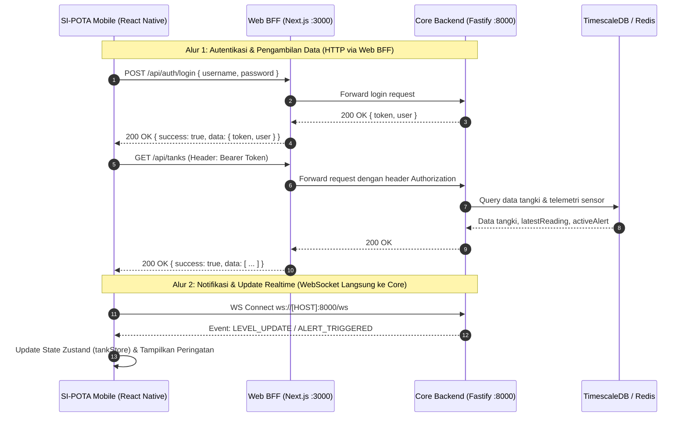

# 📱 SI-POTA Mobile v1.0 — Aplikasi Seluler Pemantauan Tangki Air (RSA UGM)

Selamat datang di repositori resmi **Aplikasi Seluler (Mobile App)** untuk proyek **Work Package 4 (WP-4): Sistem Informasi Pemantauan dan Pengendalian Level Air Berbasis IoT di Rumah Sakit Akademik (RSA) Universitas Gadjah Mada**.

Aplikasi ini dibangun menggunakan **React Native (Expo SDK 58)** dan dirancang khusus sebagai alat pemantauan saku (*pocket glance tool*) bagi staf fasilitas dan teknisi lapangan yang bermobilitas tinggi di lingkungan rumah sakit.

> **Dokumen Referensi Utama:**
> * Master Frontend PRD: [`docs/PRD-MFE.md`](docs/PRD-MFE.md)
> * Spesifikasi Teknis Mobile: [`docs/PRD-Mobile.md`](docs/PRD-Mobile.md)

---

## 📖 Gambaran Umum & Visi Produk

Petugas pemeliharaan fasilitas RSA UGM berpindah secara konstan antar-gedung (Gedung Utama/A, Rawat Inap/B, Bedah Sentral, Laundry, dsb). **SI-POTA Mobile** hadir untuk memberikan informasi ketinggian air dan peringatan dini secara cepat langsung dari genggaman ponsel.

### Karakteristik Desain:
* **Orientasi Vertikal (*Portrait-first*):** Tata letak yang dioptimalkan untuk penggunaan satu tangan ramah sentuhan jempol (*thumb-friendly*).
* **Desain Clean Light Medis:** Visual bersih, cerah, dan profesional yang selaras 100% dengan dashboard web desktop RSA UGM.
* **Ringan & Hemat Kuota:** Komputasi data mentah dan filtering telah diramu di sisi backend/BFF, sehingga ponsel menerima data siap render tanpa menguras baterai.
* **Responsif Edge-to-Edge:** Mendukung standar tampilan modern Android 15 & iOS Notch/Dynamic Island secara dinamis melalui `react-native-safe-area-context`.

### ⚠️ Batasan Ruang Lingkup Mutlak (Scope Boundaries)
1. **Monitoring & Early Warning Saja:** Aplikasi berfungsi menampilkan ketinggian air, visual progress bar, grafik ringkas 24 jam, status konektivitas radio LoRa, dan menyelesaikan peringatan (*Resolve Alert*).
2. **DILARANG KERAS MEMBUAT KONTROL POMPA:** Seluruh saklar on/off pompa fisik, katup aktuator, atau manipulasi motor air ditiadakan dari aplikasi seluler demi menjaga keselamatan instalasi pipa rumah sakit dan mencegah salah pencet di lapangan.

---

## ✨ Fitur Utama (Berdasarkan PRD-Mobile)

Mengacu pada spesifikasi **F-01 s.d. F-08** dalam [`docs/PRD-Mobile.md`](docs/PRD-Mobile.md):

| Kode | Nama Fitur | Deskripsi & Implementasi Mobile |
| :--- | :--- | :--- |
| **F-01** | **Beranda Pemantauan Tangki (*Glance Home*)** | Menampilkan kartu tangki vertikal dengan **Auto-Sort by Severity** (tangki berstatus *CRITICAL* $<30\%$ dan *WARNING* $30-60\%$ otomatis diposisikan paling atas). Dilengkapi persentase angka besar, volume aktual (Liter), dan badge status. |
| **F-02** | **Tren Riwayat Air 24 Jam Ringkas** | Visualisasi tren pergerakan air 24 jam terakhir dalam bentuk *sparkline* ringkas pada modal detail tangki. |
| **F-03** | **Peringatan Darurat Realtime (*In-App Alert*)** | Banner merah interaktif saat air menipis, lonceng notifikasi pada header, dan getaran native saat terjadi bahaya air. |
| **F-04** | **Penyelesaian Peringatan (*Mobile Resolve*)** | Teknisi lapangan dapat menyelesaikan status alarm langsung dari HP via endpoint `PATCH /api/alerts/:id/resolve` setelah mengecek kondisi fisik tangki. |
| **F-05** | **Status Konektivitas Perangkat (*Devices Status*)** | Menampilkan status radio LoRa STM32, indikator sinyal RSSI (dBm), dan waktu *heartbeat* Raspberry Pi Gateway Hub. |
| **F-06\***| **Kalibrasi Ambang Batas Ringkas (*Quick Threshold*)** | *(Khusus Admin)* Membuka *bottom sheet* untuk mengatur batas `Min Threshold %` dan `Max Threshold %` tangki secara langsung di lokasi. |
| **F-07\***| **Kelola Operator Cepat (*Mobile User Management*)** | *(Khusus Admin)* Menampilkan daftar teknisi dengan toggle switch aktivasi/deaktivasi akun operator lapangan. |
| **F-08\***| **Feed Aktivitas Lapangan (*Recent Activity Timeline*)** | *(Khusus Admin/Operator)* Menampilkan 20 riwayat audit aksi operasional terakhir dengan narasi ramah baca. |

*\*Fitur bertanda bintang hanya dapat diakses oleh pengguna dengan role `admin`.*

---

## 🛠️ Teknologi & Dependensi (Tech Stack)

Aplikasi dibangun di atas pondasi runtime Expo modern:

| Komponen / Pustaka | Versi | Peran & Penggunaan |
| :--- | :--- | :--- |
| **Framework Mobile** | **React Native 0.88.0** | Engine native Android & iOS modern dengan dukungan default *Edge-to-Edge* |
| **Ekosistem Aplikasi**| **Expo SDK 58** (`~58.0.19`) | Toolchain modern Expo dengan mekanisme Continuous Native Generation (CNG) |
| **Bahasa Pemrograman**| **TypeScript ~6.0.3** | Menjamin type-safety dan deteksi kesalahan sejak dini |
| **Library UI Reaktif** | **React 19.3.0** | Library rendering UI reaktif generasi terbaru |
| **State Management** | **Zustand ^5.0.16** | Pengelola state global klien (`authStore`, `tankStore`, dll) yang ringan |
| **HTTP Client** | **Axios ^1.20.0** | Komunikasi HTTP dengan JWT request interceptor otomatis |
| **Status Bar Engine** | **Expo Status Bar ~58.0.4** | Penanganan status bar yang kompatibel dengan tema gelap/terang |
| **Safe Area Insets** | **react-native-safe-area-context ~5.10.1** | Penanganan notch, punch-hole kamera, dan navigation bar perangkat |

---

## 🌐 Arsitektur Jaringan & Integrasi Data

Aplikasi seluler mengonsumsi data secara terstruktur dengan dua metode:



---

## 🚀 Panduan Memulai untuk Tim Pengembang (Developer Onboarding)

Ikuti langkah-langkah berikut saat pertama kali melakukan kloning repositori ini:

### 1. Prasyarat Sistem
* **Node.js**: Versi LTS ($\ge 20.x$).
* **Git**: Terpasang di laptop pengembang.
* **Aplikasi Pengujian**:
  * **HP Fisik (Rekomendasi)**: Pasang aplikasi **Expo Go** dari Google Play Store (Android) atau App Store (iOS).
  * **Emulator**: Atau gunakan **Android Studio Emulator**.

---

### 2. Kloning Repositori
```bash
git clone https://github.com/PMLD-RSA/frontend-mobile-rsa-ugm.git
cd frontend-mobile-rsa-ugm
```

---

### 3. Pemasangan Dependensi
Pasang seluruh paket dependensi resmi Expo SDK 58:
```bash
npm install
```

---

### 4. Konfigurasi Environment (`.env`)
Salin template `.env.example` menjadi `.env`:

```bash
# Windows PowerShell
Copy-Item .env.example .env

# Linux / macOS / Git Bash
cp .env.example .env
```

Buka file `.env`, lalu pilih salah satu skenario target dan **uncomment**:

```env
# ==============================================================================
# ALAMAT WEB BFF NEXT.JS (Port 3000) - Pilih salah satu dan uncomment
# ==============================================================================

# 1. Local Browser / Web Preview
EXPO_PUBLIC_BFF_URL=http://localhost:3000

# 2. Android Studio Emulator
# EXPO_PUBLIC_BFF_URL=http://10.0.2.2:3000

# 3. HP Fisik (Satu jaringan WiFi) -> Ubah <IP_LAN_LAPTOP>
# EXPO_PUBLIC_BFF_URL=http://<IP_LAN_LAPTOP>:3000

# 4. HP Fisik (Via Tailscale) -> Ubah <IP_TAILSCALE_LAPTOP> (misal: 100.67.180.76)
# EXPO_PUBLIC_BFF_URL=http://<IP_TAILSCALE_LAPTOP>:3000

# 5. Production (BFF sudah di-deploy) -> Ubah <DOMAIN_BFF_ANDA>
# EXPO_PUBLIC_BFF_URL=https://<DOMAIN_BFF_ANDA>.vercel.app


# ==============================================================================
# ALAMAT WEBSOCKET CORE BACKEND (Port 8000) - Pilih salah satu dan uncomment
# ==============================================================================

# 1. Local 
EXPO_PUBLIC_WS_URL=ws://localhost:8000/ws

# 2. Via Tailscale -> Ubah <IP_TAILSCALE_BACKEND>
# EXPO_PUBLIC_WS_URL=ws://<IP_TAILSCALE_BACKEND>:8000/ws

# 3. Production (Sudah di-deploy, gunakan wss://) -> Ubah <DOMAIN_API_ANDA>
# EXPO_PUBLIC_WS_URL=wss://<DOMAIN_API_ANDA>/ws
```

> [!TIP]
> Jika menguji dari **HP fisik**, pilih opsi **3 (LAN WiFi)** atau **4 (Tailscale)**. Hindari membiarkan `localhost` di HP fisik karena ponsel akan menghubungi dirinya sendiri dan menyebabkan status *⚠️ BFF Offline*.

---

### 5. Memastikan Web BFF Sedang Berjalan
Karena Mobile mengonsumsi data melalui Web BFF, pastikan repositori **`frontend-web-rsa-ugm`** sudah berjalan di latar belakang:
```bash
# Di terminal frontend-web-rsa-ugm:
pnpm run dev
# Pastikan Web BFF aktif di port 3000 (http://localhost:3000/api/tanks)
```

---

### 6. Menjalankan Server Pengembangan Mobile (Metro)
```bash
npx expo start
```
Atau jika ingin membersihkan cache bundler:
```bash
npx expo start -c
```

**Cara Menghubungkan:**
* **Buka di HP Fisik:** Buka aplikasi **Expo Go**, lalu pindai (*scan*) QR Code yang muncul di terminal komputer Anda.
* **Buka di Android Emulator:** Tekan tombol `a` pada keyboard di terminal.
* **Buka di Browser Web:** Tekan tombol `w` pada keyboard di terminal.

---

### 7. Verifikasi Kualitas & Integritas Kode
Sebelum membuat commit atau Pull Request, pastikan seluruh pemeriksaan berikut lolos:

```bash
# 1. Pengecekan Type-safety TypeScript
npx tsc --noEmit

# 2. Diagnostik Kesehatan Lingkungan Expo (20 Parameter)
npx expo-doctor

# 3. Uji Coba Ekspor Produksi (Dry Run)
npx expo export --no-bytecode
```

---

## 📁 Struktur Direktori Repositori

```text
frontend-mobile-rsa-ugm/
├── .expo/                        # Cache dan metadata bundler Expo
├── assets/                       # Aset ikon aplikasi, splash, dan favicon
├── docs/                         # Acuan spesifikasi kebutuhan teknis
│   ├── PRD-MFE.md                # Master Frontend PRD
│   └── PRD-Mobile.md             # Acuan Tunggal Spesifikasi Mobile
├── src/
│   ├── components/
│   │   ├── Card.tsx              # Komponen Kartu dasar & Badge status dot semantik
│   │   ├── Header.tsx            # Custom Top Header dengan tombol hamburger & profil
│   │   ├── MetricsOverview.tsx   # 3 Kartu metrik ringkasan kapasitas & alert
│   │   ├── Sidebar.tsx           # Navigasi Sliding Drawer hardware-accelerated
│   │   └── TankCard.tsx          # Kartu tangki dengan progress bar & modul radio LoRa
│   ├── config/
│   │   └── env.ts                # Konfigurasi binding IP fallback (BFF_URL & WS_URL)
│   ├── screens/
│   │   ├── HomeScreen.tsx        # Beranda glance list dengan Severity Auto-Sort
│   │   └── PlaceholderScreen.tsx # Template layar modul yang sedang dalam pengembangan
│   ├── services/
│   │   ├── secureStore.ts        # Enkripsi hardware untuk simpan JWT Bearer Token
│   │   └── api.ts                # Axios client terpusat dengan SecureStore interceptor
│   ├── stores/
│   │   ├── authStore.ts          # Zustand: autentikasi, sesi pengguna, & auto-login
│   │   └── tankStore.ts          # Zustand: daftar tangki & live update telemetry
│   └── types/
│       └── index.ts              # Type definitions resmi selaras Web BFF & Drizzle
├── .env.example                  # Template panduan konfigurasi variabel lingkungan
├── app.json                      # Konfigurasi Expo & manifest aplikasi (CNG)
├── App.tsx                       # Root container, SafeAreaProvider & Main Dashboard
├── index.ts                      # Entrypoint Expo registerRootComponent
├── package.json                  # Dependensi proyek (Expo SDK 58, React 19, RN 0.88)
└── tsconfig.json                 # Konfigurasi TypeScript compiler
```

---

## 🛡️ Kebijakan Branch & Standar Commit

* **Branch Utama**:
  * `main`: Cabang produksi (*Production Release*).
  * `dev`: Cabang pengembangan utama (*Staging*). Seluruh Pull Request fitur ditujukan ke branch ini.
* **Penamaan Branch**:
  * Fitur baru: `feat/<nama-fitur>`
  * Perbaikan bug: `fix/<nama-isu>`
  * Konfigurasi & CI: `ci/<nama-tugas>` atau `chore/<nama-tugas>`
* **Format Pesan Commit**:
  Menggunakan standar **Conventional Commits**:
  * `feat(ui): implement glance home card with auto-severity sorting`
  * `fix(network): handle offline state gracefully in tank store`
  * `style(theme): refine clean light theme and badge indicators`
  * `docs(readme): update developer onboarding guide and environment setup`

---

*Dikelola oleh Tim Pengembang Work Package 4 (WP-4) — Rumah Sakit Akademik Universitas Gadjah Mada* 🏥
