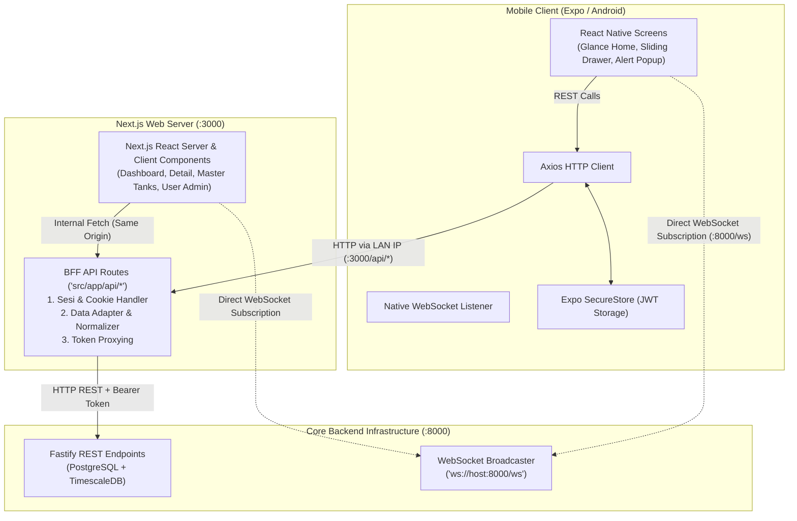
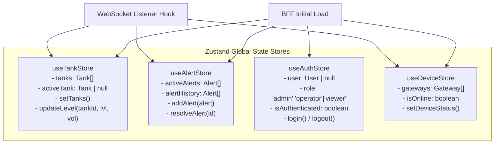
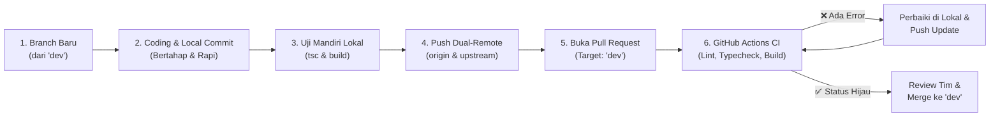

# 📋 Product Requirements Document — Master Frontend (PRD-MFE)
# Integrated Hospital Water Tank Monitoring & Early Warning System (RSA UGM)
### Nama Sistem: SI-POTA v1.0 (Sistem Informasi Pemantauan Tangki Air)

> **Repositori Dokumentasi:** `frontend-documentation-rsa-ugm`  
> **Parent Architecture (Source of Truth):** [`PRD.md`](./PRD.md) *(Backend Core Fastify v5, TimescaleDB, MQTT, WebSocket)*  
> **Child Platform PRDs:**  
> 1. Web Dashboard & BFF: [`web/PRD-Web.md`](./web/PRD-Web.md) $\longrightarrow$ Target Repo: `frontend-web-rsa-ugm`  
> 2. Mobile App (Android): [`mobile/PRD-Mobile.md`](./mobile/PRD-Mobile.md) $\longrightarrow$ Target Repo: `frontend-mobile-rsa-ugm`  
> **Arsitektur Utama:** Decoupled Multi-Platform dengan **Next.js Backend-for-Frontend (BFF)**  
> **Tim Pengembang (WP-4):** 4 Personil (2 Pengembang Web/BFF + 2 Pengembang Mobile)  
> **Status Dokumen:** Master Guide & Acuan Tunggal Seluruh Frontend

---

## 1. Visi, Latar Belakang & Ruang Lingkup Master FE

### 1.1 Visi Produk (Product Vision)
Menyajikan antarmuka pemantauan ketinggian air rumah sakit yang **intuitif, instan, andal, dan zero-lag** bagi petugas fasilitas, operator ruang kontrol (*control room*), dan pimpinan Rumah Sakit Akademik UGM. Sistem harus mampu mengubah data telemetri IoT mentah dari sensor STM32 menjadi visualisasi level air yang mudah dipahami dalam hitungan detik.

### 1.2 Batasan Ruang Lingkup (Scope & Boundaries)
Berdasarkan spesifikasi mutlak pada [`PRD.md` (Backend)](./PRD.md):
1. **Fokus Murni Monitoring & Early Warning:**
   * Menampilkan volume dan persentase air tangki secara berkala dan realtime.
   * Memberikan sinyal visual dan peringatan bahaya (*WARNING* $30-60\%$ dan *CRITICAL* $<30\%$).
   * Menyediakan aksi konfirmasi/penyelesaian peringatan (*Alert Resolution*) untuk operator.
   * Menyajikan grafik time-series pembacaan 24 jam dan status kesehatan perangkat gateway.
2. **BATASAN TEGAS (DILARANG MEMBUAT KONTROL POMPA):**
   * Antarmuka Web dan Mobile **DILARANG KERAS** menyediakan tombol saklar, switch, atau formulir untuk mematikan/menghidupkan pompa air fisik atau katup solenoid.
   * Seluruh jalur kontrol aktuator fisik ditiadakan demi keselamatan dan keandalan sistem perpipaan rumah sakit.

### 1.3 Glosarium Istilah Frontend
* **BFF (Backend-for-Frontend):** Lapisan perantara di Next.js App Router API Routes (`/api/*`) yang menjembatani klien Web/Mobile dengan Core Backend Fastify.
* **Gauge Card:** Komponen kartu tangki yang menampilkan persentase air dalam bentuk indikator visual level air bertingkat atau silinder terisi cairan.
* **Dual-Mode Connection:** Pola konsumsi data di mana data awal dimuat via HTTP REST API, kemudian langsung disinkronkan secara realtime via WebSocket.
* **HTTP-Only Cookie:** Mekanisme pengamanan token JWT di peramban Web yang mencegah pencurian sesi via Cross-Site Scripting (XSS).
* **SecureStore:** Media enkripsi penyimpanan kredensial pada ponsel pintar Android/iOS melalui pustaka native `expo-secure-store`.
* **Zustand Store:** Pengelola state global klien yang ringan dan reaktif untuk menyimpan daftar tangki, peringatan aktif, dan sesi pengguna.

---

## 2. Konsolidasi Tech Stack & Lingkungan Kerja

Pilihan teknologi diselaraskan 100% dengan dependensi yang telah terpasang pada repositori `frontend-web-rsa-ugm` dan `frontend-mobile-rsa-ugm`:

### 2.1 Matriks Teknologi Multi-Platform

| Layer / Kategori | Frontend Web & BFF (`frontend-web-rsa-ugm`) | Frontend Mobile (`frontend-mobile-rsa-ugm`) |
| :--- | :--- | :--- |
| **Framework Utama** | **Next.js 16.3.x (App Router)** | **React Native 0.86.x via Expo SDK 57** |
| **Bahasa Pemrograman** | TypeScript 5.x | TypeScript 6.x |
| **UI & Styling** | Tailwind CSS v4 & Lucide Icons | StyleSheet Native, Custom Dark Medical UI |
| **State Management** | **Zustand v5** | **Zustand v5** |
| **HTTP Client** | Native `fetch` (Server & Client) | **Axios v1.20+** |
| **Data Visualization** | **Recharts v3** (Area & Line Time-Series) | Native SVG / Bar Gauge & Sparkline |
| **Security Storage** | Server-side `cookies()` (HTTP-Only) | **Expo SecureStore** |
| **Realtime Channel** | WebSocket Client (`ws://.../ws`) | WebSocket Client Native (`ws://.../ws`) |
| **Port / Runtime** | Port `3000` (Next.js Dev Server) | Port `8081` (Metro Bundler) |

### 2.2 Konfigurasi Environment & Komunikasi Jaringan

```text
[Core Backend Fastify]     --> Port 8000 (REST API & WebSocket /ws)
[Web Dashboard + BFF]      --> Port 3000 (UI Web & API Routes BFF)
[Mobile Expo App]          --> Port 8081 (Emulator / HP Fisik via IP LAN: 192.168.x.x atau 10.x.x.x)
```

* **Variabel Web (`.env.local`):**
  * `CORE_BACKEND_URL=http://localhost:8000` (Akses server-to-server BFF ke Fastify)
  * `NEXT_PUBLIC_WS_URL=ws://localhost:8000/ws` (Akses langsung WebSocket dari browser)
* **Variabel Mobile (`.env` / Konfigurasi App):**
  * `EXPO_PUBLIC_BFF_URL=http://<IP_LAN_HOST>:3000` (Akses HTTP Axios ke Web BFF)
  * `EXPO_PUBLIC_WS_URL=ws://<IP_LAN_HOST>:8000/ws` (Akses WebSocket langsung ke Fastify)

---

## 3. Arsitektur Komunikasi Data & Pola BFF

Sistem menerapkan pola **Backend-for-Frontend (BFF)** dengan Next.js App Router sebagai simpul koordinasi:



### Mengapa Next.js API Routes sebagai BFF Bersama?
1. **Efisiensi Infrastruktur:** Tidak memerlukan container atau server NodeJS tambahan khusus BFF. API BFF hidup berdampingan dengan frontend web dalam satu build.
2. **Single Source of Adapter:** Jika Core Backend mengubah format respons atau struktur parameter, modifikasi hanya dilakukan pada adapter rute Next.js BFF (`frontend-web-rsa-ugm/src/app/api/*`). Klien Web dan Mobile tidak perlu dirombak total.
3. **Pemisahan Keamanan Sesi:**
   * Klien Web tidak pernah menyimpan token JWT di `localStorage` (rentan XSS). Web BFF mengelolanya melalui cookie `HttpOnly; SameSite=Lax; Secure`.
   * Klien Mobile menerima JWT murni dari respons login BFF untuk disimpan ke dalam *hardware-backed storage* (`expo-secure-store`).

---

## 4. Matriks Pemetaan Fitur Frontend (Web vs Mobile)

Berdasarkan 8 fitur inti yang disediakan Backend (`F-01` s.d. `F-08`), berikut pembagian implementasi pada platform Web dan Mobile:

| Kode Fitur | Nama Fitur | Dukungan Web | Dukungan Mobile | Role Akses Minimum | Keterangan Tampilan UI |
| :--- | :--- | :---: | :---: | :---: | :--- |
| **F-01** | **Live Monitoring Level Air** | ✅ | ✅ | `viewer` | **Web:** Grid kartu ultrawide & gauge silinder interaktif.<br>**Mobile:** Vertical scroll glance cards & badge status. |
| **F-02** | **Histori & Grafik 24 Jam** | ✅ | ✅ *(Sederhana)* | `viewer` | **Web:** Grafik Recharts time-series interaktif multi-tangki.<br>**Mobile:** Grafik tren garis tunggal / sparkline ringkas per tangki. |
| **F-03** | **Sistem Deteksi Peringatan** | ✅ | ✅ | `viewer` | **Web:** Floating emergency banner di header & halaman alert.<br>**Mobile:** Banner darurat merah & modal alert popup responsif. |
| **F-04** | **Penyelesaian Alert (Resolve)** | ✅ | ✅ | `operator` | **Web:** Tombol "Resolve" pada tabel & panel alert.<br>**Mobile:** Tombol "Selesaikan" di kartu alert / modal saat inspeksi. |
| **F-05** | **Status Konektivitas Perangkat**| ✅ | ✅ *(Ringkas)* | `viewer` | **Web:** Halaman tabel status RPi & STM32 (RSSI & Heartbeat).<br>**Mobile:** Indikator dot status online/offline di header kartu tangki. |
| **F-06** | **Manajemen Master Tangki** | ✅ | ✅ *(Ringkas - Admin)* | `admin` | **Web:** Tabel master data CRUD lengkap dengan form modal.<br>**Mobile:** Bottom sheet edit threshold (min/max %) cepat saat inspeksi lapangan. |
| **F-07** | **Manajemen Pengguna (User)** | ✅ | ✅ *(Ringkas - Admin)* | `admin` | **Web:** Tabel user lengkap, form tambah, ubah role & reset password.<br>**Mobile:** List kartu operator ringkas dengan toggle aktif/nonaktif & reset cepat. |
| **F-08** | **Audit Trail & Ekspor Laporan** | ✅ | ✅ *(Ringkas - Op/Admin)*| `operator` | **Web:** Data table log aktivitas sistem & unduh berkas CSV.<br>**Mobile:** Timeline feed aktivitas terbaru (10-20 aksi) & ringkasan alert mingguan. |

---

### 4.1 Prinsip Implementasi Fitur Ringkas di Mobile (F-06 s.d. F-08)
Agar aplikasi Mobile tetap gesit, ringan, dan tidak membingungkan pengguna dengan tampilan desktop yang dipaksakan (*plek-ketiplek*), fitur administratif diadaptasi dengan pendekatan *Mobile-First Essentials*:

1. **F-06 (Master Tangki di Mobile):**
   * Tidak menampilkan tabel spreadsheet kolom banyak.
   * Admin dapat menekan tombol *Settings/Edit* pada kartu tangki untuk membuka **Bottom Sheet Edit Cepat**.
   * Fokus utama di mobile adalah **menyesuaikan persentase batas bahaya (`minThresholdPercent` & `maxThresholdPercent`)** saat petugas melakukan kalibrasi langsung di atas atap tangki fisik.
2. **F-07 (Manajemen Pengguna di Mobile):**
   * Ditampilkan sebagai sub-menu di Sliding Drawer khusus akun Admin.
   * Tampilan berupa kartu ringkas berisi nama operator, role, dan **Switch/Toggle On-Off status aktif**.
   * Memudahkan Admin rumah sakit memblokir akses atau mereset akun secara instan dari ponsel jika terjadi kendala operasional.
3. **F-08 (Audit Trail di Mobile):**
   * Disajikan sebagai **Timeline Feed (Aktivitas Terkini)**: menampilkan 10 hingga 20 log terakhir dalam format kartu naratif (contoh: *"Budi Santoso menyelesaikan Alert Tangki Atap - 10 menit lalu"*).
   * Menghilangkan tabel audit raksasa agar memori ponsel tetap ringan dan data cepat termuat.

---

## 5. Spesifikasi Rute BFF & Integrasi Kontrak API

Seluruh 24 titik integrasi API yang tercantum pada [PRD Backend](./PRD.md#60-master-checklist-api-yang-wajib-dicover-frontend) dipetakan melalui rute BFF Next.js (`frontend-web-rsa-ugm/src/app/api/`):

### 5.1 Daftar Lengkap Rute BFF (`/api/*`) — Cakupan 100% Backend

Seluruh endpoint yang disediakan Fastify Core Backend dipetakan 1-to-1 melalui rute BFF Next.js (`frontend-web-rsa-ugm/src/app/api/`) agar klien Web dan Mobile memiliki gerbang antarmuka yang seragam:

| No | Endpoint BFF (Next.js) | Target Core BE (Fastify) | Method | Min. Role | Deskripsi Fungsi & Peran Adaptasi BFF |
| :-: | :--- | :--- | :---: | :---: | :--- |
| 1 | `/api/health` | `/health` | `GET` | Public | Cek status server BFF dan status koneksi ke Core Backend & DB. |
| 2 | `/api/auth/login` | `/api/auth/login` | `POST` | Public | Validasi kredensial: set HTTP-Only cookie (Web) & kirim token JWT (Mobile). |
| 3 | `/api/auth/me` | `/api/auth/me` | `GET` | Viewer | Verifikasi token aktif dari cookie/header dan kembalikan profil user. |
| 4 | `/api/auth/logout` | *(BFF Sesi Handler)* | `POST` | Viewer | Menghapus cookie `auth_token` di browser dan mereset sesi lokal. |
| 5 | `/api/tanks` | `/api/tanks` | `GET` | Viewer | Daftar seluruh tangki lengkap dengan `latestReading` & `activeAlert`. |
| 6 | `/api/tanks/[id]` | `/api/tanks/:id` | `GET` | Viewer | Detail lengkap 1 tangki spesifik beserta 50 log pembacaan terakhir. |
| 7 | `/api/tanks/[id]/readings` | `/api/tanks/:id/readings` | `GET` | Viewer | Data log time-series per tangki (`?hours=24&limit=100`) untuk grafik garis. |
| 8 | `/api/tanks` | `/api/tanks` | `POST` | Admin | *(Admin)* Proksi pendaftaran master tangki baru (kapasitas & threshold). |
| 9 | `/api/tanks/[id]` | `/api/tanks/:id` | `PUT` / `PATCH` | Admin | *(Admin)* Proksi update data kapasitas, nama, lokasi, & threshold bahaya. |
| 10 | `/api/tanks/[id]` | `/api/tanks/:id` | `DELETE` | Admin | *(Admin)* Proksi penghapusan master tangki dari sistem. |
| 11 | `/api/readings/latest` | `/api/readings/latest` | `GET` | Viewer | Polling fallback cepat status ketinggian air seluruh tangki. |
| 12 | `/api/readings/history` | `/api/readings/history` | `GET` | Viewer | Riwayat agregasi multi-tangki selama 24 jam terakhir untuk overview chart. |
| 13 | `/api/alerts` | `/api/alerts` | `GET` | Viewer | Riwayat peringatan air (`?status=active` atau `?status=resolved`). |
| 14 | `/api/alerts/[id]/resolve`| `/api/alerts/:id/resolve`| `PATCH` / `PUT` | Operator | *(Operator/Admin)* Aksi penyelesaian manual status alert tangki. |
| 15 | `/api/gateways` | `/api/gateways` | `GET` | Viewer | Status konektivitas Raspberry Pi Hub (online/offline & last heartbeat). |
| 16 | `/api/nodes` | `/api/nodes` | `GET` | Viewer | Rincian modul sensor STM32 di tangki (RSSI sinyal LoRa, status & last seen). |
| 17 | `/api/users` | `/api/users` | `GET` | Admin | *(Admin)* Mengambil seluruh daftar akun pengguna (admin, operator, viewer). |
| 18 | `/api/users` | `/api/users` | `POST` | Admin | *(Admin)* Mendaftarkan akun operator/viewer baru ke sistem. |
| 19 | `/api/users/[id]` | `/api/users/:id` | `PATCH` / `PUT` | Admin | *(Admin)* Memperbarui status akun (aktif/nonaktif), role, atau reset password. |
| 20 | `/api/users/[id]` | `/api/users/:id` | `DELETE` | Admin | *(Admin)* Menonaktifkan (*soft-delete*) akun pengguna dari sistem. |
| 21 | `/api/audit-logs` | `/api/audit-logs` | `GET` | Operator | Rekaman log jejak aktivitas operasional pengguna (login, resolve alert, dll). |
| 22 | `/api/reports/readings/export`| `/api/reports/readings/export`| `GET` | Operator | Unduh file spreadsheet CSV rekam data sensor (`?tankId=...&from=...&to=...`). |
| 23 | `/api/reports/alerts/export`| `/api/reports/alerts/export`| `GET` | Operator | Unduh file spreadsheet CSV riwayat peringatan bahaya level air. |

> 🌐 **Catatan Protokol Realtime (WebSocket):**  
> Event realtime (`LEVEL_UPDATE`, `ALERT_TRIGGERED`, `ALERT_RESOLVED`, `NODE_STATUS`) **tidak melalui polling HTTP BFF**, melainkan dikonsumsi langsung oleh browser dan mobile melalui koneksi socket persisten ke Core Backend: `ws://<HOST_IP>:8000/ws`. Rute `/api/readings/latest` di BFF disiapkan sebagai jaring pengaman (*fallback*) otomatis jika koneksi WebSocket terganggu.

---

### 5.2 Strategi Sinkronisasi Realtime (WebSocket Dual-Mode)

Klien Web dan Mobile mengimplementasikan hook koneksi WebSocket langsung ke Core Backend:
* **Endpoint Socket:** `ws://<HOST_IP>:8000/ws`
* **Logika Sinkronisasi State:**

```mermaid
sequenceDiagram
    autonumber
    participant UI as Component (Web/Mobile)
    participant Store as Zustand (Tank & Alert Store)
    participant BFF as Next.js BFF (:3000)
    participant WS as Fastify WebSocket (:8000)

    UI->>BFF: 1. Initial Load: GET /api/tanks
    BFF-->>UI: Kembalikan Snapshot Seluruh Tangki
    UI->>Store: Set initialTanks state

    UI->>WS: 2. Buka Koneksi WebSocket ('ws://...:8000/ws')
    WS-->>UI: Event: CONNECTED { clientId, timestamp }

    loop Pemantauan Realtime
        WS->>>UI: Event: LEVEL_UPDATE { tankId, levelPercent, volumeLiters }
        UI->>Store: updateTankLevel(tankId, levelPercent, volumeLiters)
        Store-->>UI: Re-render komponen kartu & gauge (Zero Latency)

        opt Jika Terjadi Anomali
            WS->>>UI: Event: ALERT_TRIGGERED { id, tankId, level: 'CRITICAL', message }
            UI->>Store: addActiveAlert(alertData)
            Store-->>UI: Tampilkan Emergency Banner / Play Audio Warning
        end

        opt Saat Kondisi Kembali Normal
            WS->>>UI: Event: ALERT_RESOLVED { id, tankId }
            UI->>Store: removeActiveAlert(id)
            Store-->>UI: Sembunyikan Emergency Banner
        end
    end

    opt Jika Koneksi WebSocket Putus (Jaringan Error)
        UI->>UI: Mulai Exponential Backoff Reconnect
        loop Polling Fallback (Tiap 10 Detik)
            UI->>BFF: GET /api/readings/latest
            BFF-->>UI: Update level air sementara via HTTP
        end
    end
```

---

## 6. Standar Keamanan & Manajemen Sesi (AAA)

Mekanisme Autentikasi, Otorisasi, dan Akunting diterapkan secara terpisah sesuai karakteristik platform:

### 6.1 Alur Autentikasi Web (Zero-Trust Session via HTTP-Only Cookie)
1. Pengguna memasukkan `username` dan `password` di form login Web.
2. Form memanggil `POST /api/auth/login` pada Next.js BFF.
3. Next.js BFF meneruskan kredensial ke Fastify Core Backend (`POST /api/auth/login`).
4. Core Backend memverifikasi dan mengembalikan token JWT.
5. BFF menyematkan token JWT ke dalam header HTTP:
   ```http
   Set-Cookie: auth_token=<JWT_TOKEN>; HttpOnly; Path=/; SameSite=Lax; Max-Age=86400
   ```
6. Browser tidak dapat membaca token via JavaScript (`document.cookie`), menutup celah serangan XSS secara mutlak.
7. Pada setiap pemanggilan API berikutnya, browser otomatis mengirimkan cookie tersebut, dan route handler Next.js menyalinnya ke header `Authorization: Bearer <JWT_TOKEN>` saat menghubungi Core Backend.

### 6.2 Alur Autentikasi Mobile (Hardware-Backed SecureStore)
1. Petugas memasukkan kredensial pada layar login aplikasi Expo.
2. Axios mengirimkan request ke `http://<IP_LAN>:3000/api/auth/login`.
3. BFF mengembalikan payload JSON sukses berisi string `token` dan data user.
4. Aplikasi Mobile menyimpan token menggunakan pustaka `expo-secure-store`:
   ```typescript
   await SecureStore.setItemAsync('user_token', res.data.data.token);
   ```
5. Axios Interceptor otomatis menyematkan header `Authorization: Bearer <token>` pada seluruh request selanjutnya.

### 6.3 Kontrol Akses Berbasis Peran (RBAC di Sisi Klien)
* **`admin`:** 
  * **Web:** Akses penuh ke seluruh menu (Overview, Detail Tangki, Alert, Device Status, Master Tangki CRUD, Kelola Pengguna, dan Audit Log).
  * **Mobile:** Menampilkan tombol quick-edit threshold tangki (F-06), menu Manajemen Pengguna ringkas dengan toggle aktif/nonaktif di drawer (F-07), serta Timeline Aktivitas Terkini (F-08).
* **`operator`:** 
  * **Web:** Akses ke Overview, Detail Tangki, Alert, Device Status, tombol **Resolve Alert**, dan Ekspor Laporan. Menu Master Tangki dan User Management disembunyikan.
  * **Mobile:** Akses pemantauan tangki, penerimaan alert realtime, tombol **Resolve Alert**, dan Timeline Aktivitas Terkini. Menu kelola tangki & user tidak ditampilkan.
* **`viewer`:** 
  * Hanya memiliki akses membaca (*read-only*) ke Overview, Detail Tangki, dan Device Status di Web maupun Mobile. Seluruh tombol aksi modifikasi atau penyelesaian alert dinonaktifkan/disembunyikan.

---

## 7. Design System & Panduan Visual Terpadu

### 7.1 Identitas Visual & Palet Warna Status

Mengadopsi identitas medis modern bernuansa *Hospital Clean & Dark Mode*:

| Kategori Status | Rentang Level | Hex Code (Light / Dark) | Makna Fungsional |
| :--- | :--- | :--- | :--- |
| **Normal** | $> 60.00\%$ | `#10B981` / `#34D399` | Pasokan air aman, kapasitas optimal. |
| **Warning** | $30.00\% - 60.00\%$ | `#F59E0B` / `#FBBF24` | Level air berkurang, perlu pemantauan debit pengisian. |
| **Critical** | $< 30.00\%$ | `#EF4444` / `#F87171` | Kondisi darurat, suplai air terancam habis. |
| **Brand Primary** | — | `#0A354C` / `#0F766E` | Warna dasar header, sidebar, dan brand RSA UGM. |
| **Background** | — | `#F8FAFC` / `#0B132B` | Latar belakang dashboard utama. |
| **Card Surface** | — | `#FFFFFF` / `#1C2541` | Latar komponen kartu tangki dan panel widget. |

### 7.2 Tipografi & Hierarki Layout
* **Font Family:** Inter, Roboto, atau font Sans-Serif sistem.
* **Format Angka Volume:** Ditampilkan dengan pemisah ribuan standar Indonesia (contoh: `7.240 Liter` atau `10.000 Liter`).
* **Format Persentase:** Presisi 1 desimal (contoh: `72.4%`).
* **Layout Web:** Dioptimalkan untuk monitor resolusi tinggi / *ultrawide* ruang kontrol rumah sakit (grid 3 hingga 4 kolom).
* **Layout Mobile:** Dioptimalkan untuk orientasi vertikal (*portrait*) satu kolom pada layar ponsel Android petugas (lebar 360px - 420px).

---

## 8. Arsitektur State Management (Zustand Global Stores)

Untuk menjamin sinkronisasi data instan antara Web dan Mobile tanpa *prop drilling*, state frontend dibagi ke dalam 4 modul store terisolasi:



---

## 9. Git Workflow, Branch Protection & Otomasi CI (GitHub Actions)

Mengingat repositori Frontend Web dan Mobile sangat sensitif dan dikerjakan secara paralel oleh tim WP-4, sistem menerapkan aturan ketat (*Quality Gates*) sebelum kode dapat digabungkan ke branch utama:

### 9.1 Kebijakan Branch Protection & Dual-Remote
1. **Dual-Remote Strategy:**
   * `origin`: Repositori personal tim / staging (`https://github.com/Avin1731/...`).
   * `upstream`: Repositori organisasi utama / basis produksi (`https://github.com/PMLD-RSA/...`).
2. **Branch Protection Terpasang pada `main` dan `dev`:**
   * **Dilarang Direct Push:** Siapa pun (termasuk Admin) dilarang melakukan `git push` langsung ke branch `main` dan `dev`.
   * **Wajib Pull Request (PR):** Seluruh integrasi kode baru wajib melalui mekanisme Pull Request dengan branch target `dev`.
   * **Require Status Checks:** Tombol *Merge* di GitHub dikunci secara otomatis sampai seluruh *job* pada pipeline Continuous Integration (CI) dinyatakan **HIJAU (PASSED)**.

---

### 9.2 Siklus Hidup Pull Request (PR Lifecycle)



1. **Pembuatan Branch:** Selalu buat branch fitur baru bercabang dari commit terbaru `dev` (contoh: `feat/web-tanks-grid` atau `feat/mobile-alert-modal`).
2. **Commit Lokal Berkala:** Lakukan commit bertahap dengan pesan yang jelas (mengikuti konvensi *Conventional Commits*: `feat: ...`, `fix: ...`, `refactor: ...`).
3. **Validasi Mandiri Lokal (Wajib Sebelum Push):**
   * Web: `pnpm run lint` && `npx tsc --noEmit` && `pnpm run build`
   * Mobile: `npx tsc --noEmit` && `npx expo export --platform android`
4. **Push ke Dual-Remote:** Setelah dipastikan bebas error di mesin lokal, branch fitur di-push ke kedua remote (`origin` dan `upstream`).
5. **Buka Pull Request:** Buat PR di GitHub dengan target branch `dev`. Isi deskripsi PR dengan ringkasan fitur yang diselesaikan.

---

### 9.3 Pipeline Continuous Integration (CI) GitHub Actions
*(Catatan: Continuous Deployment / CD dilewati sementara karena fase rilis server produksi masih jauh; fokus saat ini adalah quality gate CI otomatis)*.

Pipeline CI dipasang pada file `.github/workflows/ci.yml` di masing-masing repositori dengan spesifikasi:

#### A. Pipeline CI Web (`frontend-web-rsa-ugm/.github/workflows/ci.yml`)
* **Pemicu (*Trigger*):** Pull Request ke `dev` & `main`, serta push ke `feat/*`.
* **Urutan Eksekusi Job:**
  1. **Checkout Code:** `actions/checkout@v4`
  2. **Setup Node.js & pnpm:** Node.js v20 LTS dan `pnpm/action-setup@v3`
  3. **Install Dependencies:** `pnpm install --frozen-lockfile`
  4. **Linting Check:** `pnpm run lint` (ESLint 9)
  5. **Typecheck Strict:** `npx tsc --noEmit` (TypeScript 5)
  6. **Production Build Test:** `pnpm run build` (Memvalidasi kompilasi Next.js App Router, Tailwind CSS v4, dan seluruh endpoint BFF tanpa crash SSR/prerender).

#### B. Pipeline CI Mobile (`frontend-mobile-rsa-ugm/.github/workflows/ci.yml`)
* **Pemicu (*Trigger*):** Pull Request ke `dev` & `main`, serta push ke `feat/*`.
* **Urutan Eksekusi Job:**
  1. **Checkout Code:** `actions/checkout@v4`
  2. **Setup Node.js:** Node.js v20 LTS dengan cache `npm`
  3. **Install Dependencies:** `npm ci`
  4. **Typecheck Strict:** `npx tsc --noEmit` (TypeScript 6)
  5. **Expo Healthcheck:** `npx expo-doctor` (Memastikan kompatibilitas pustaka native Expo SDK 57)
  6. **Dry Export Bundle:** `npx expo export --platform android` (Memverifikasi pembuatan bundle JavaScript native Android tanpa broken imports).

---

## 10. Matriks Pengujian Frontend & Definition of Done (DoD)

Sebuah fitur dinyatakan selesai (*Done*) jika memenuhi kriteria pengujian berikut:

| No | Modul Uji | Target Verifikasi | Tolok Ukur Keberhasilan |
| :-: | :--- | :--- | :--- |
| 1 | **Status Threshold UI** | Komponen Kartu & Gauge | Warna berubah otomatis: Hijau ($>60\%$), Kuning ($30-60\%$), Merah ($<30\%$). |
| 2 | **Realtime Responsiveness** | Event `LEVEL_UPDATE` | UI memperbarui angka level air tanpa perlu me-refresh halaman web/layar ponsel. |
| 3 | **Alert Banner & Sound** | Event `ALERT_TRIGGERED` | Banner darurat merah muncul seketika saat simulasi tangki menyentuh level $<30\%$. |
| 4 | **Resolve Action** | Tombol "Resolve" | Aksi memanggil endpoint PATCH, status berubah jadi `resolved`, banner tertutup. |
| 5 | **BFF Session Proxy** | Halaman Admin Web | Pengguna `operator` ditolak mengakses menu kelola master tangki dan user. |
| 6 | **Mobile LAN Connectivity** | Axios di Expo Android | Aplikasi berhasil memuat data dari Web BFF via alamat IP LAN WiFi lokal. |
| 7 | **Network Disconnect Fallback**| Putus koneksi server | UI menampilkan indikator koneksi terputus dan beralih ke mode auto-reconnect. |
