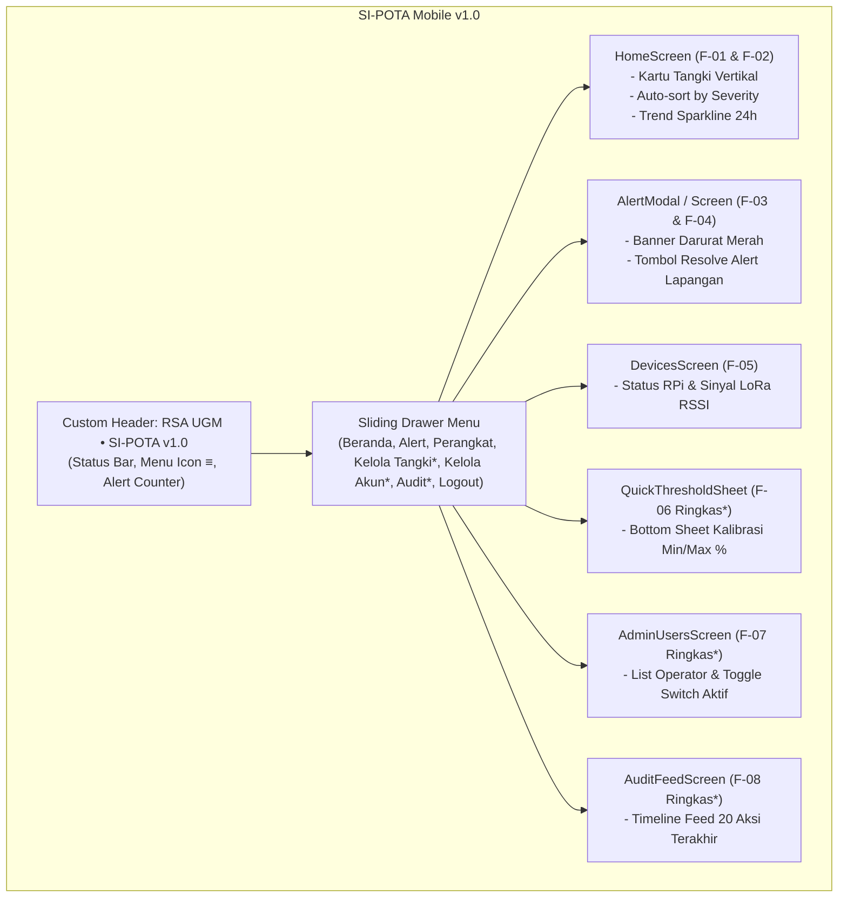

# 📋 Product Requirements Document — Mobile App (PRD-Mobile)
# Integrated Hospital Water Tank Monitoring & Early Warning System (RSA UGM)
### Platform: React Native Expo Mobile App (Android)
### Nama Aplikasi: SI-POTA Mobile v1.0

> **Repositori Target Pengembangan:** `frontend-mobile-rsa-ugm`  
> **Parent Documentation:** [`../PRD-MFE.md`](../PRD-MFE.md) *(Master Frontend PRD)* & [`../PRD.md`](../PRD.md) *(Backend Core)*  
> **Arsitektur:** React Native 0.86, Expo SDK 57, TypeScript 6, Zustand v5, Axios, Expo SecureStore  
> **Port Pengembangan:** Metro Bundler `http://localhost:8081` (Koneksi HP Fisik via IP LAN WiFi)  
> **Status Dokumen:** Acuan Tunggal Spesifikasi Frontend Mobile (Android)

---

## 1. Deskripsi Singkat, Visi & Peran Mobile App

### 1.1 Visi Produk Mobile
Aplikasi SI-POTA Mobile dirancang khusus sebagai alat pemantauan saku (*pocket glance tool*) bagi **petugas fasilitas dan teknisi lapangan** Rumah Sakit Akademik UGM yang memiliki mobilitas tinggi berpindah antar-gedung (Gedung Utama, Rawat Inap, Bedah Sentral, Laundry, dll). 

Antarmuka mobile harus berorientasi **vertikal (*portrait*)**, ringan, hemat daya baterai, ramah sentuhan jari (*finger-friendly*), serta mampu memberikan **peringatan darurat instan (*realtime emergency alerts*)** langsung di genggaman tangan petugas saat berada di lapangan.

### 1.2 Karakteristik Interaksi & Arsitektur Konsumsi Data
1. **Konsumsi Data Melalui Web BFF:**
   * Aplikasi Mobile **TIDAK** menembak langsung endpoint mentah Core Backend Fastify, melainkan berkomunikasi secara terpusat melalui **Next.js Web BFF (`http://<LAN_IP>:3000/api/*`)**.
   * *Keuntungan:* Data mentah dari sensor sudah dibersihkan, dihitung persentasenya, dan distrukturkan oleh server BFF, sehingga beban komputasi dan memori pada *smartphone* petugas menjadi sangat minim.
2. **Koneksi Realtime Langsung (WebSocket):**
   * Untuk mendengarkan pembaruan level air tanpa delay (*zero-latency*), aplikasi mobile membuka koneksi socket persisten langsung ke Core Backend: `ws://<LAN_IP>:8000/ws`.

### 1.3 Batasan Ruang Lingkup Mutlak (Scope Boundaries)
* **Monitoring & Early Warning Saja:** Aplikasi mobile murni berfungsi membaca level air, mendeteksi peringatan darurat, melakukan penyelesaian alert (*Resolve Alert*), memeriksa status sinyal radio sensor LoRa, dan menyediakan fungsi administratif ringkas bagi Admin.
* **DILARANG KERAS MEMBUAT KONTROL POMPA:** Tidak diperbolehkan ada tombol saklar, switch on/off pompa fisik, atau katup aktuator apa pun di layar ponsel. Seluruh instruksi aktuasi fisik ditiadakan demi keselamatan instalasi pipa rumah sakit.

---

## 2. Tech Stack & Lingkungan Kerja Mobile

| Komponen / Pustaka | Versi Terpasang | Peran & Penggunaan |
| :--- | :--- | :--- |
| **Framework Utama** | **React Native 0.86.x via Expo SDK 57** | Fondasi pengembangan aplikasi Android native |
| **Bahasa Pemrograman** | TypeScript 6.x | Menjamin type-safety dan pencegahan runtime error |
| **HTTP Client** | **Axios v1.20+** | Komunikasi HTTP terpusat dengan interceptor token ke Web BFF |
| **State Management** | **Zustand v5.0.x** | Pengelola state global klien (Tanks, Alerts, Auth, Devices) |
| **Keamanan Kredensial**| **Expo SecureStore** (`expo-secure-store`) | Enkripsi hardware untuk menyimpan JWT Bearer Token di HP |
| **Navigasi UI** | Custom Mobile Sliding Drawer (`Sidebar.tsx`) | Navigasi menu samping yang mulus tanpa tumpukan memori |
| **Visualisasi Indikator**| Custom Native Gauge & Card (`Card.tsx`) | Komponen visual level air, badge status, dan sinyal RSSI |
| **Realtime Channel** | Native `WebSocket` API | Menerima event realtime `LEVEL_UPDATE` & `ALERT_*` dari Fastify |
| **Runtime & Bundler** | Metro Bundler (Port 8081) | Tool kompilasi dan hot-reloading Expo Go |

### Konfigurasi Jaringan & Alamat IP Lokal (`src/config/env.ts`)
Karena emulator Android atau HP fisik tidak dapat mengakses `localhost` laptop secara langsung:
```typescript
// IP Host Laptop/Server Pengembangan pada jaringan WiFi yang sama
export const ENV = {
  // Akses ke Web BFF (Next.js Port 3000)
  BFF_URL: process.env.EXPO_PUBLIC_BFF_URL || "http://192.168.1.15:3000",

  // Akses Realtime WebSocket ke Core Backend (Fastify Port 8000)
  WS_URL: process.env.EXPO_PUBLIC_WS_URL || "ws://192.168.1.15:8000/ws",
};
```

---

## 3. Struktur Direktori & Arsitektur Komponen

Struktur direktori pada `frontend-mobile-rsa-ugm/src` diorganisasi secara modular:

```text
src/
├── components/
│   ├── Card.tsx                  # Base card & Badge status level air
│   ├── Sidebar.tsx               # Custom Sliding Drawer navigation
│   ├── LiquidLevelGauge.tsx      # Komponen gauge silinder tangki vertikal
│   ├── AlertModal.tsx            # Modal darurat popup saat air < 30%
│   ├── QuickThresholdSheet.tsx   # Bottom sheet edit threshold (F-06 ringkas)
│   └── Header.tsx                # Custom Top Header (Status bar, Menu button, Judul)
├── services/
│   ├── api.ts                    # Axios client instance + SecureStore interceptor
│   └── websocket.ts              # WebSocket listener client singleton
├── stores/
│   ├── tankStore.ts              # Zustand: daftar tangki & live update level
│   ├── alertStore.ts             # Zustand: alert aktif & aksi resolve
│   ├── authStore.ts              # Zustand: user login, role, & status auth
│   └── deviceStore.ts            # Zustand: gateway & node status connectivity
├── screens/
│   ├── LoginScreen.tsx           # Layar masuk kredensial petugas
│   ├── HomeScreen.tsx            # Beranda pemantauan tangki (Glance list)
│   ├── TankDetailModal.tsx       # Detail spesifik tangki & grafik ringkas
│   ├── AlertsScreen.tsx          # Riwayat alert & tombol penyelesaian
│   ├── DevicesScreen.tsx         # Status sinyal LoRa RSSI & Hub RPi
│   ├── AdminUsersScreen.tsx      # Kelola operator ringkas (F-07)
│   └── AuditFeedScreen.tsx       # Timeline aktivitas terbaru (F-08)
├── config/
│   └── env.ts                    # IP binding configuration
└── types/
    └── index.ts                  # TypeScript interfaces (Tank, Alert, User, etc.)
```

---

## 4. Rincian Implementasi Fitur Mobile (F-01 s.d. F-08)

Sesuai ketetapan Master PRD, aplikasi Mobile mengimplementasikan seluruh fitur fungsional dengan pendekatan **ringkas, esensial, dan ramah sentuhan jempol**:


*(Tanda `*` menandakan fitur administratif khusus pengguna ber-role `admin`)*.

---

### 4.1 F-01: Beranda Pemantauan Tangki (*Glance Home*)
* **Tujuan:** Menyajikan status ketinggian air seluruh tangki rumah sakit secara sekilas saat petugas berkeliling.
* **Fitur Utama:**
  * **Auto-Sort by Severity:** Tangki yang berada pada kondisi darurat (**CRITICAL** $<30\%$ atau **WARNING** $30-60\%$) otomatis ditempatkan di posisi **paling atas layar**.
  * **Komponen Kartu Tangki (`Card.tsx`):**
    * Nama Tangki (contoh: *Tangki Atap Gedung Utama*) dan Lokasi fisik (*Lantai 5 Gedung A*).
    * Indikator Level Persentase dengan angka besar (contoh: `72.4%`).
    * Estimasi Volume Air (contoh: `7.240 / 10.000 L`).
    * Badge Status Semantik: **NORMAL** (Hijau), **WARNING** (Kuning), **CRITICAL** (Merah).
    * Indikator Sinyal LoRa: Ikon radio dengan nilai RSSI (contoh: `-74 dBm`).
    * Tombol *"Detail Tangki"* untuk membuka popup detail.

### 4.2 F-02: Tren Riwayat Air 24 Jam Ringkas (*Sparkline Trend*)
* **Tujuan:** Memberikan gambaran sekilas apakah volume air sedang naik (terisi) atau sedang menyusut drastis.
* **Bentuk di Mobile:** Bukan grafik kompleks multi-layer desktop, melainkan **grafik garis ringkas (*sparkline*)** atau bar visual 24 jam terakhir yang tertanam langsung di modal detail tangki.

### 4.3 F-03: Peringatan Darurat Realtime (*In-App Emergency Alert*)
* **Tujuan:** Menyiagakan petugas di lapangan sesegera mungkin saat air menipis.
* **Bentuk di Mobile:**
  * **Top Alert Banner:** Banner merah menyala melayang di bawah header jika terdeteksi tangki berstatus `CRITICAL`.
  * **Haptic Vibration & Sound:** Memicu getaran native ponsel saat event WebSocket `ALERT_TRIGGERED` diterima.
  * **Lonceng Peringatan:** Badge angka merah pada header yang menunjukkan jumlah alert aktif.

### 4.4 F-04: Penyelesaian Peringatan Langsung di Lapangan (*Mobile Resolve*)
* **Tujuan:** Memberikan kemudahan bagi teknisi untuk menyelesaikan alert langsung dari ponsel setelah selesai mengecek kondisi tangki fisik di atap gedung.
* **Alur Interaksi:**
  1. Petugas membuka daftar alert atau mengklik alert banner.
  2. Menekan tombol besar **"Selesaikan Peringatan (Resolve)"**.
  3. Aplikasi menampilkan konfirmasi singkat: *"Apakah kondisi fisik tangki sudah dipastikan normal?"*.
  4. Aplikasi mengirimkan request `PATCH /api/alerts/:id/resolve` ke BFF.
  5. Alert tertutup seketika dan status tangki kembali aman.

### 4.5 F-05: Status Perangkat Lapangan (*Connectivity Status*)
* **Tujuan:** Memastikan modul radio LoRa STM32 dan Raspberry Pi Hub tidak mati atau kehilangan sinyal.
* **Bentuk di Mobile:**
  * Dot hijau/merah di header kartu tangki menandakan koneksi aktif.
  * Layar *Devices Screen*: Menampilkan daftar node per tangki beserta nilai dBm RSSI terakhir dan waktu heartbeat RPi Hub.

---

### 4.6 F-06: Manajemen Master Tangki Ringkas (*Quick Threshold Sheet* — Khusus Admin)
* **Tujuan:** Memudahkan Admin rumah sakit mengubah batas ambang peringatan air saat melakukan inspeksi fisik di lokasi.
* **Bentuk di Mobile:**
  * Tombol ikon gear/edit pada kartu tangki (hanya muncul jika role login adalah `admin`).
  * Membuka **Bottom Sheet** dari bawah layar:
    * Input batas bawah bahaya: `Min Threshold (%)` (default: 30%).
    * Input batas atas: `Max Threshold (%)` (default: 90%).
    * Tombol *"Simpan Perubahan"*.
  * Mengirim request `PUT /api/tanks/:id` ke Web BFF tanpa harus membuka laptop.

### 4.7 F-07: Manajemen Pengguna Ringkas (*Mobile Operator Management* — Khusus Admin)
* **Tujuan:** Memberikan kontrol darurat kepada Admin untuk mengaktifkan/menonaktifkan akun operator langsung dari HP.
* **Bentuk di Mobile:**
  * Layar *Kelola Pengguna* diakses dari Sliding Drawer Admin.
  * Menampilkan daftar nama operator dalam bentuk kartu ringkas.
  * Terdapat **Switch / Toggle Switch (Aktif / Nonaktif)** di setiap baris akun.
  * Tombol *"Reset Sandi"* cepat yang menghasilkan kata sandi sementara jika ada operator di lapangan yang terkunci akunnya.

### 4.8 F-08: Feed Aktivitas Terbaru (*Recent Activity Timeline* — Khusus Op/Admin)
* **Tujuan:** Memberikan transparansi operasional tanpa membebani ponsel dengan data ribuan baris.
* **Bentuk di Mobile:**
  * Menyajikan **Timeline Feed 10–20 log aktivitas terakhir** berbasis data dari `GET /api/audit-logs?limit=20`.
  * Format naratif ramah baca:
    * *"Budi Santoso menyelesaikan Alert Tangki Atap (12 mnt lalu)"*
    * *"Admin memperbarui ambang batas Tangki Bedah ke 35% (1 jam lalu)"*
    * *"Teknisi login dari IP 192.168.1.45 (2 jam lalu)"*

---

## 5. Integrasi Data & Alur Komunikasi Dual-Mode

Aplikasi Mobile menerapkan strategi sinkronisasi **Dual-Mode** (HTTP Initial Load via Web BFF + Persistent Realtime via WebSocket Core):

```mermaid
sequenceDiagram
    autonumber
    participant App as Mobile UI (React Native)
    participant Store as Zustand (Tank & Alert Store)
    participant Secure as Expo SecureStore
    participant BFF as Next.js Web BFF (:3000)
    participant WS as Fastify WebSocket Core (:8000)

    %% Initial Load
    App->>Secure: Baca Token JWT Tersimpan
    Secure-->>App: Kembalikan 'auth_token'
    App->>BFF: HTTP GET /api/tanks (Header: Bearer <token>)
    BFF-->>App: JSON Snapshot Seluruh Tangki
    App->>Store: setTanks(data)
    Store-->>App: Render Kartu Tangki di Beranda

    %% Realtime Streaming
    App->>WS: Buka Socket 'ws://<LAN_IP>:8000/ws'
    WS-->>App: Event CONNECTED

    loop Aliran Data Realtime
        WS->>>App: Event LEVEL_UPDATE { tankId, levelPercent, volumeLiters }
        App->>Store: updateLevel(tankId, levelPercent, volumeLiters)
        Store-->>App: Re-render Angka & Animasi Air (Instant)

        opt Jika Terjadi Level Air Kritis
            WS->>>App: Event ALERT_TRIGGERED { id, tankId, level: 'CRITICAL' }
            App->>Store: addAlert(alertData)
            App->>App: Picu Getaran Haptic & Tampilkan Alert Banner Merah
        end
    end

    %% Fallback jika WiFi terputus
    opt Jika Koneksi WebSocket Putus
        App->>App: Mulai Reconnect Interval (Tiap 5 Detik)
        loop Polling Cadangan
            App->>BFF: GET /api/readings/latest
            BFF-->>App: Update Level Air via Polling HTTP
        end
    end
```

---

## 6. Standar Keamanan & Manajemen Kredensial (AAA di Mobile)

### 6.1 Penyimpanan Terenkripsi via `expo-secure-store`
Aplikasi mobile **DILARANG MENGGUNAKAN `AsyncStorage` BIASA** untuk menyimpan token autentikasi. Seluruh token JWT wajib disimpan menggunakan hardware encryption native:

```typescript
import * as SecureStore from "expo-secure-store";

const TOKEN_KEY = "sipota_auth_token";

export async function saveAuthToken(token: string): Promise<void> {
  await SecureStore.setItemAsync(TOKEN_KEY, token);
}

export async function getAuthToken(): Promise<string | null> {
  return await SecureStore.getItemAsync(TOKEN_KEY);
}

export async function removeAuthToken(): Promise<void> {
  await SecureStore.deleteItemAsync(TOKEN_KEY);
}
```

### 6.2 Axios Interceptor Otomatis (`src/services/api.ts`)
```typescript
import axios from "axios";
import { getAuthToken } from "./secureStore";
import { ENV } from "../config/env";

export const api = axios.create({
  baseURL: ENV.BFF_URL,
  timeout: 10000,
});

api.interceptors.request.use(async (config) => {
  const token = await getAuthToken();
  if (token) {
    config.headers.Authorization = `Bearer ${token}`;
  }
  return config;
});

api.interceptors.response.use(
  (res) => res,
  (err) => {
    if (err.response?.status === 401) {
      // Sesi kedaluwarsa: hapus token dan kembali ke layar login
      console.warn("[Auth] Sesi berakhir, redirect ke login");
    }
    return Promise.reject(err);
  }
);
```

---

## 7. Design System Mobile & Dark Medical Theme

Mengadopsi nuansa medis profesional gelap (*Hospital Clean Dark UI*) yang nyaman di mata petugas saat bertugas malam:

### 7.1 Palet Warna Status & UI
* **Brand Primary:** `#0A354C` (Warna dasar Top Header & Navigasi Drawer)
* **Background Utama:** `#0B132B` (Latar belakang gelap layar beranda)
* **Surface Kartu Tangki:** `#1C2541` (Latar komponen kartu dengan elevasi halus)
* **Batas Kartu / Border:** `#3A506B`
* **Status Normal:** `#10B981` (Hijau zamrud — level $> 60\%$)
* **Status Warning:** `#F59E0B` (Kuning amber — level $30\% - 60\%$)
* **Status Critical:** `#EF4444` (Merah menyala — level $< 30\%$)
* **Teks Utama:** `#FFFFFF` (Putih terang) & **Teks Sekunder:** `#94A3B8` (Abu-abu kebiruan)

### 7.2 Ergonomi Sentuhan Jari (*Touch Ergonomics*)
* Seluruh tombol aksi (tombol menu drawer `≡`, tombol *Resolve*, tombol detail) memiliki **area sentuh minimal $44 \times 44\text{ dp}$** untuk mencegah salah tekan saat petugas menggunakan sarung tangan atau tergesa-gesa.

---

## 8. Pipeline CI GitHub Actions (`.github/workflows/ci.yml`)

Repositori `frontend-mobile-rsa-ugm` diproteksi secara otomatis melalui pipeline CI untuk memvalidasi setiap Pull Request ke branch `dev` dan `main`:

```yaml
name: Mobile CI (Typecheck & Expo Dry Export)

on:
  push:
    branches:
      - "feat/*"
  pull_request:
    branches:
      - dev
      - main

jobs:
  validate-mobile:
    name: TypeScript Check & Expo Healthcheck
    runs-on: ubuntu-latest
    steps:
      - name: Checkout Code
        uses: actions/checkout@v4

      - name: Setup Node.js 20 LTS
        uses: actions/setup-node@v4
        with:
          node-version: 20
          cache: "npm"

      - name: Install Dependencies
        run: npm ci

      - name: Strict TypeScript Verification
        run: npx tsc --noEmit

      - name: Expo Compatibility Doctor
        run: npx expo-doctor

      - name: Dry Export Android Bundle
        run: npx expo export --platform android
        env:
          EXPO_PUBLIC_BFF_URL: "http://localhost:3000"
          EXPO_PUBLIC_WS_URL: "ws://localhost:8000/ws"
```

---

## 9. Panduan Memulai Cepat untuk Pengembang Mobile

1. Masuk ke direktori repositori mobile:
   ```bash
   cd frontend-mobile-rsa-ugm
   ```
2. Instalasi seluruh dependensi npm:
   ```bash
   npm install
   ```
3. Cek alamat IP LAN komputer Anda (misal `ipconfig` di Windows):
   * Pastikan `App.tsx` atau `src/config/env.ts` mengarah ke IP LAN tersebut (contoh: `http://192.168.1.15:3000`).
4. Jalankan bundler Expo:
   ```bash
   npx expo start
   ```
5. Scan QR Code menggunakan aplikasi **Expo Go** di ponsel pintar Android Anda (pastikan ponsel dan laptop berada di jaringan WiFi/Hotspot yang sama).
6. Lakukan validasi mandiri sebelum mengajukan Pull Request:
   ```bash
   npx tsc --noEmit && npx expo export --platform android
   ```
