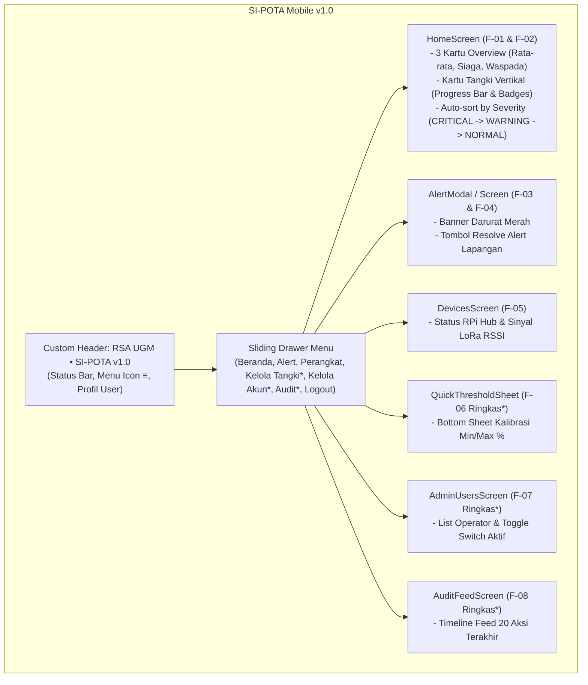
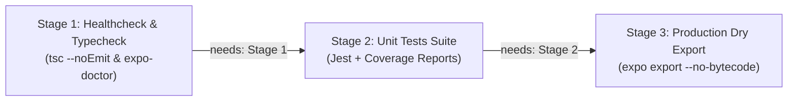

# 📋 Product Requirements Document — Mobile App (PRD-Mobile)
# Integrated Hospital Water Tank Monitoring & Early Warning System (RSA UGM)
### Platform: React Native Expo Mobile App (Android & iOS)
### Nama Aplikasi: SI-POTA Mobile v1.0

> **Repositori Target Pengembangan:** `frontend-mobile-rsa-ugm`  
> **Parent Documentation:** [`PRD-MFE.md`](./PRD-MFE.md) *(Master Frontend PRD)* & [`../../PRD.md`](../../PRD.md) *(Backend Core)*  
> **Arsitektur:** React Native 0.88.0, Expo SDK 58, React 19.3.0, TypeScript ~6.0.3, Zustand ^5.0.16, Axios ^1.20.0, Expo SecureStore ~58.0.2, Jest ^30.5.2, ts-jest ^29.4.15  
> **CI / Quality Gate:** GitHub Actions Multi-Stage Workflow (Healthcheck, Unit Tests, Dry Export)  
> **Port Pengembangan:** Metro Bundler `http://localhost:8081` (Koneksi HP Fisik via IP LAN WiFi / Tailscale)  
> **Status Dokumen:** Acuan Tunggal Spesifikasi Frontend Mobile (Android & iOS)

---

## 1. Deskripsi Singkat, Visi & Peran Mobile App

### 1.1 Visi Produk Mobile
Aplikasi SI-POTA Mobile dirancang khusus sebagai alat pemantauan saku (*pocket glance tool*) bagi **petugas fasilitas dan teknisi lapangan** Rumah Sakit Akademik UGM yang memiliki mobilitas tinggi berpindah antar-gedung (Gedung Utama, Rawat Inap, Bedah Sentral, Laundry, dll). 

Antarmuka mobile berorientasi **vertikal (*portrait-first*)**, ringan, hemat daya baterai, ramah sentuhan jari (*thumb-friendly*), serta mampu memberikan **peringatan darurat instan (*realtime emergency alerts*)** langsung di genggaman tangan petugas saat berada di lapangan.

### 1.2 Karakteristik Interaksi & Arsitektur Konsumsi Data
1. **Konsumsi Data Melalui Web BFF:**
   * Aplikasi Mobile **TIDAK** menembak langsung endpoint mentah Core Backend Fastify, melainkan berkomunikasi secara terpusat melalui **Next.js Web BFF (`http://<LAN_IP>:3000/api/*`)**.
   * *Keuntungan:* Data mentah dari sensor sudah dibersihkan, dihitung persentasenya, dan distrukturkan oleh server BFF, sehingga beban komputasi dan memori pada *smartphone* petugas menjadi sangat minim.
2. **Koneksi Realtime Langsung (WebSocket):**
   * Untuk mendengarkan pembaruan level air tanpa delay (*zero-latency*), aplikasi mobile membuka koneksi socket persisten langsung ke Core Backend: `ws://<LAN_IP>:8000/ws`.

### 1.3 Batasan Ruang Lingkup Mutlak (Scope Boundaries)
* **Monitoring & Early Warning Saja:** Aplikasi mobile murni berfungsi membaca level air, mendeteksi peringatan darurat, melakukan penyelesaian alert (*Resolve Alert*), memeriksa status sinyal radio sensor LoRa, dan menyediakan fungsi administratif ringkas bagi Admin.
* **DILARANG KERAS MEMBUAT KONTROL POMPA:** Tidak diperbolehkan ada tombol saklar, switch on/off pompa fisik, atau katup aktuator apa pun di layar ponsel. Seluruh instruksi aktuasi fisik ditiadakan demi keselamatan instalasi pipa rumah sakit.

---

## 2. Tech Stack & Lingkungan Kerja Mobile

Aplikasi dibangun di atas pondasi runtime Expo modern:

| Komponen / Pustaka | Versi Terpasang | Peran & Penggunaan |
| :--- | :--- | :--- |
| **Framework Mobile** | **React Native 0.88.0** | Engine native Android & iOS modern dengan dukungan default *Edge-to-Edge* |
| **Ekosistem Aplikasi**| **Expo SDK 58** (`~58.0.19`) | Toolchain modern Expo dengan mekanisme Continuous Native Generation (CNG) |
| **Bahasa Pemrograman**| **TypeScript ~6.0.3** | Menjamin type-safety dan deteksi kesalahan sejak dini |
| **Library UI Reaktif** | **React 19.3.0** | Library rendering UI reaktif generasi terbaru |
| **State Management** | **Zustand ^5.0.16** | Pengelola state global klien (`authStore`, `tankStore`, dll) yang ringan |
| **HTTP Client** | **Axios ^1.20.0** | Komunikasi HTTP dengan JWT request interceptor otomatis |
| **Penyimpanan Kredensial**| **Expo SecureStore ~58.0.2** | Enkripsi hardware native (Keystore/Keychain) untuk menyimpan JWT Bearer Token |
| **Unit Testing Engine**| **Jest ^30.5.2 & ts-jest ^29.4.15** | Pengujian unit otomatis super cepat dengan metrik code coverage |
| **CI / Quality Gate** | **GitHub Actions Multi-Stage** | Validasi otomatis 3 tahap (Healthcheck, Tests, dan Bundling) di cloud |
| **Status Bar Engine** | **Expo Status Bar ~58.0.4** | Penanganan status bar yang kompatibel dengan tema terang/gelap |
| **Safe Area Insets** | **react-native-safe-area-context ~5.10.1** | Penanganan notch, punch-hole kamera, dan navigation bar perangkat |
| **Navigasi UI** | Custom Mobile Sliding Drawer (`Sidebar.tsx`) | Navigasi menu samping hardware-accelerated yang mulus tanpa bloatware |
| **Realtime Channel** | Native `WebSocket` API | Menerima event realtime `LEVEL_UPDATE` & `ALERT_*` langsung dari Fastify |
| **Runtime & Bundler** | Metro Bundler (Port 8081) | Tool kompilasi dan hot-reloading Expo Go |

### 2.1 Konfigurasi Environment & Alamat IP (`src/config/env.ts`)
Aplikasi seluler mengadopsi struktur konfigurasi yang bersih dan terisolasi. Kode aplikasi membaca variabel environment dari `.env` dengan fallback ke localhost:

```typescript
export const ENV = {
  BFF_URL: process.env.EXPO_PUBLIC_BFF_URL || "http://localhost:3000",
  WS_URL: process.env.EXPO_PUBLIC_WS_URL || "ws://localhost:8000/ws",
};
```

Pengembang cukup menyalin file `.env.example` menjadi `.env` dan memilih skenario koneksi yang sesuai:

```env
# Skenario 1: Browser Lokal
EXPO_PUBLIC_BFF_URL=http://localhost:3000
EXPO_PUBLIC_WS_URL=ws://localhost:8000/ws

# Skenario 2: Android Studio Emulator
# EXPO_PUBLIC_BFF_URL=http://10.0.2.2:3000
# EXPO_PUBLIC_WS_URL=ws://10.0.2.2:8000/ws

# Skenario 3: HP Fisik via WiFi LAN
# EXPO_PUBLIC_BFF_URL=http://<IP_LAN_LAPTOP>:3000
# EXPO_PUBLIC_WS_URL=ws://<IP_LAN_LAPTOP>:8000/ws

# Skenario 4: HP Fisik via Tailscale VPN
# EXPO_PUBLIC_BFF_URL=http://<IP_TAILSCALE>:3000
# EXPO_PUBLIC_WS_URL=ws://<IP_TAILSCALE>:8000/ws

# Skenario 5: Produksi Cloud
# EXPO_PUBLIC_BFF_URL=https://<DOMAIN_BFF>.vercel.app
# EXPO_PUBLIC_WS_URL=wss://<DOMAIN_API>/ws
```

---

## 3. Struktur Direktori & Arsitektur Komponen

Struktur direktori pada `frontend-mobile-rsa-ugm` diorganisasi secara modular dan teruji:

```text
frontend-mobile-rsa-ugm/
├── .github/
│   └── workflows/
│       └── ci.yml                # Multi-Stage CI Pipeline GitHub Actions (3 Stages)
├── __tests__/
│   ├── env.test.ts               # Unit test konfigurasi environment & fallback
│   └── tankMetrics.test.ts       # Unit test kalkulasi volume, threshold & severity sorting
├── .expo/                        # Cache dan metadata bundler Expo
├── assets/                       # Aset ikon aplikasi, splash, dan favicon
├── docs/                         # Acuan spesifikasi kebutuhan teknis
│   ├── PRD-MFE.md                # Master Frontend PRD
│   └── PRD-Mobile.md             # Acuan Tunggal Spesifikasi Mobile
├── src/
│   ├── components/
│   │   ├── Card.tsx              # Komponen Kartu dasar & Badge status dot semantik
│   │   ├── Header.tsx            # Custom Top Header dengan tombol hamburger & profil
│   │   ├── MetricsOverview.tsx   # 3 Kartu metrik ringkasan kapasitas & alert
│   │   ├── Sidebar.tsx           # Navigasi Sliding Drawer hardware-accelerated
│   │   └── TankCard.tsx          # Kartu tangki dengan progress bar & modul radio LoRa
│   ├── config/
│   │   └── env.ts                # Konfigurasi binding IP fallback (BFF_URL & WS_URL)
│   ├── screens/
│   │   ├── HomeScreen.tsx        # Beranda glance list dengan Severity Auto-Sort
│   │   └── PlaceholderScreen.tsx # Template layar modul yang sedang dalam pengembangan
│   ├── services/
│   │   ├── secureStore.ts        # Enkripsi hardware untuk simpan JWT Bearer Token
│   │   └── api.ts                # Axios client terpusat dengan SecureStore interceptor
│   ├── stores/
│   │   ├── authStore.ts          # Zustand: autentikasi, sesi pengguna, & auto-login
│   │   └── tankStore.ts          # Zustand: daftar tangki & live update telemetry
│   ├── utils/
│   │   └── tankMetrics.ts        # Logika murni perhitungan, sorting keparahan, & format volume
│   └── types/
│       └── index.ts              # Type definitions resmi selaras Web BFF & Drizzle
├── .env.example                  # Template panduan konfigurasi variabel lingkungan
├── app.json                      # Konfigurasi Expo & manifest aplikasi (CNG)
├── App.tsx                       # Root container, SafeAreaProvider & Main Dashboard
├── index.ts                      # Entrypoint Expo registerRootComponent
├── jest.config.js                # Konfigurasi Jest test runner untuk TypeScript
├── package.json                  # Dependensi proyek (Expo SDK 58, React 19, RN 0.88, Jest)
└── tsconfig.json                 # Konfigurasi TypeScript compiler dengan tipe Jest
```

---

## 4. Rincian Implementasi Fitur Mobile (F-01 s.d. F-08)

Sesuai ketetapan Master PRD, aplikasi Mobile mengimplementasikan seluruh fitur fungsional dengan pendekatan **ringkas, esensial, dan ramah sentuhan jempol**:



*(Tanda `*` menandakan fitur administratif khusus pengguna ber-role `admin`)*.

---

### 4.1 F-01: Beranda Pemantauan Tangki (*Glance Home*)
* **Tujuan:** Menyajikan status ketinggian air seluruh tangki rumah sakit secara sekilas saat petugas berkeliling.
* **Fitur Utama:**
  * **Auto-Sort by Severity:** Tangki yang berada pada kondisi darurat (**CRITICAL** $<30\%$ atau **WARNING** $30-60\%$) otomatis ditempatkan di posisi **paling atas layar**.
  * **Komponen Overview (`MetricsOverview.tsx`):**
    * Rata-rata Ketinggian Air Rumah Sakit (persentase agregat).
    * Indikator Jumlah Tangki Status Kritis / Siaga ($<30\%$).
    * Indikator Jumlah Tangki Status Waspada ($30-60\%$).
  * **Komponen Kartu Tangki (`TankCard.tsx`):**
    * Nama Tangki (contoh: *Tangki Gedung Utama*) dan Lokasi fisik (*Lantai 5 Gedung A*).
    * Indikator Level Persentase dengan angka besar tebal (contoh: `72.4%`).
    * Estimasi Volume Air Terkini (contoh: `7.240 / 10.000 L`).
    * Bar Progress Horizontal dengan warna semantik dinamis.
    * Badge Status Dot Semantik: **NORMAL** (Hijau), **WARNING** (Kuning), **CRITICAL** (Merah).
    * Indikator Sinyal LoRa: Ikon radio dengan nilai RSSI (contoh: `-74 dBm`).

### 4.2 F-02: Tren Riwayat Air 24 Jam Ringkas (*Sparkline Trend*)
* **Tujuan:** Memberikan gambaran sekilas apakah volume air sedang naik (terisi) atau sedang menyusut drastis.
* **Bentuk di Mobile:** Bukan grafik kompleks multi-layer desktop, melainkan **grafik garis ringkas (*sparkline*)** atau bar visual 24 jam terakhir yang tertanam langsung di modal detail tangki.

### 4.3 F-03: Peringatan Darurat Realtime (*In-App Emergency Alert*)
* **Tujuan:** Menyiagakan petugas di lapangan sesegera mungkin saat air menipis.
* **Bentuk di Mobile:**
  * **Top Alert Banner:** Banner merah menyala melayang di bawah header jika terdeteksi tangki berstatus `CRITICAL`.
  * **Haptic Vibration & Sound:** Memicu getaran native ponsel saat event WebSocket `ALERT_TRIGGERED` diterima.
  * **Lonceng Peringatan:** Badge angka merah pada header yang menunjukkan jumlah alert aktif.

### 4.4 F-04: Penyelesaian Peringatan Langsung di Lapangan (*Mobile Resolve*)
* **Tujuan:** Memberikan kemudahan bagi teknisi untuk menyelesaikan alert langsung dari ponsel setelah selesai mengecek kondisi tangki fisik di atap gedung.
* **Alur Interaksi:**
  1. Petugas membuka daftar alert atau mengklik alert banner.
  2. Menekan tombol besar **"Selesaikan Peringatan (Resolve)"**.
  3. Aplikasi menampilkan konfirmasi singkat: *"Apakah kondisi fisik tangki sudah dipastikan normal?"*.
  4. Aplikasi mengirimkan request `PATCH /api/alerts/:id/resolve` ke BFF.
  5. Alert tertutup seketika dan status tangki kembali aman.

### 4.5 F-05: Status Perangkat Lapangan (*Connectivity Status*)
* **Tujuan:** Memastikan modul radio LoRa STM32 dan Raspberry Pi Hub tidak mati atau kehilangan sinyal.
* **Bentuk di Mobile:**
  * Dot hijau/merah di header kartu tangki menandakan koneksi aktif.
  * Layar *Devices Screen*: Menampilkan daftar node per tangki beserta nilai dBm RSSI terakhir dan waktu heartbeat RPi Hub.

---

### 4.6 F-06: Manajemen Master Tangki Ringkas (*Quick Threshold Sheet* — Khusus Admin)
* **Tujuan:** Memudahkan Admin rumah sakit mengubah batas ambang peringatan air saat melakukan inspeksi fisik di lokasi.
* **Bentuk di Mobile:**
  * Tombol ikon gear/edit pada kartu tangki (hanya muncul jika role login adalah `admin`).
  * Membuka **Bottom Sheet** dari bawah layar:
    * Input batas bawah bahaya: `Min Threshold (%)` (default: 30%).
    * Input batas atas: `Max Threshold (%)` (default: 90%).
    * Tombol *"Simpan Perubahan"*.
  * Mengirim request `PUT /api/tanks/:id` ke Web BFF tanpa harus membuka laptop.

### 4.7 F-07: Manajemen Pengguna Ringkas (*Mobile Operator Management* — Khusus Admin)
* **Tujuan:** Memberikan kontrol darurat kepada Admin untuk mengaktifkan/menonaktifkan akun operator langsung dari HP.
* **Bentuk di Mobile:**
  * Layar *Kelola Pengguna* diakses dari Sliding Drawer Admin.
  * Menampilkan daftar nama operator dalam bentuk kartu ringkas.
  * Terdapat **Switch / Toggle Switch (Aktif / Nonaktif)** di setiap baris akun.
  * Tombol *"Reset Sandi"* cepat yang menghasilkan kata sandi sementara jika ada operator di lapangan yang terkunci akunnya.

### 4.8 F-08: Feed Aktivitas Terbaru (*Recent Activity Timeline* — Khusus Op/Admin)
* **Tujuan:** Memberikan transparansi operasional tanpa membebani ponsel dengan data ribuan baris.
* **Bentuk di Mobile:**
  * Menyajikan **Timeline Feed 10–20 log aktivitas terakhir** berbasis data dari `GET /api/audit-logs?limit=20`.
  * Format naratif ramah baca:
    * *"Budi Santoso menyelesaikan Alert Tangki Atap (12 mnt lalu)"*
    * *"Admin memperbarui ambang batas Tangki Bedah ke 35% (1 jam lalu)"*
    * *"Teknisi login dari IP 192.168.1.45 (2 jam lalu)"*

---

## 5. Integrasi Data & Alur Komunikasi Dual-Mode

Aplikasi Mobile menerapkan strategi sinkronisasi **Dual-Mode** (HTTP Initial Load via Web BFF + Persistent Realtime via WebSocket Core):

```mermaid
sequenceDiagram
    autonumber
    participant App as Mobile UI (React Native)
    participant Store as Zustand (Tank & Alert Store)
    participant Secure as Expo SecureStore
    participant BFF as Next.js Web BFF (:3000)
    participant WS as Fastify WebSocket Core (:8000)

    %% Initial Load
    App->>Secure: Baca Token JWT Tersimpan
    Secure-->>App: Kembalikan 'auth_token'
    App->>BFF: HTTP GET /api/tanks (Header: Bearer <token>)
    BFF-->>App: JSON Snapshot Seluruh Tangki
    App->>Store: setTanks(data)
    Store-->>App: Render Kartu Tangki di Beranda (Auto-Sort Severity)

    %% Realtime Streaming
    App->>WS: Buka Socket 'ws://<HOST_IP>:8000/ws'
    WS-->>App: Event CONNECTED

    loop Aliran Data Realtime
        WS->>>App: Event LEVEL_UPDATE { tankId, levelPercent, volumeLiters }
        App->>Store: updateLevel(tankId, levelPercent, volumeLiters)
        Store-->>App: Re-render Angka, Bar & Status (Instant)

        opt Jika Terjadi Level Air Kritis
            WS->>>App: Event ALERT_TRIGGERED { id, tankId, level: 'CRITICAL' }
            App->>Store: addAlert(alertData)
            App->>App: Picu Getaran Haptic & Tampilkan Alert Banner Merah
        end
    end

    %% Fallback jika koneksi terputus
    opt Jika Koneksi WebSocket Putus
        App->>App: Mulai Reconnect Interval (Tiap 5 Detik)
        loop Polling Cadangan
            App->>BFF: GET /api/readings/latest
            BFF-->>App: Update Level Air via Polling HTTP
        end
    end
```

---

## 6. Standar Keamanan & Manajemen Kredensial (AAA di Mobile)

### 6.1 Penyimpanan Terenkripsi via `expo-secure-store`
Aplikasi mobile **DILARANG MENGGUNAKAN `AsyncStorage` BIASA** untuk menyimpan token autentikasi. Seluruh token JWT wajib disimpan menggunakan hardware encryption native:

```typescript
import * as SecureStore from "expo-secure-store";

const TOKEN_KEY = "sipota_auth_token";

export async function saveAuthToken(token: string): Promise<void> {
  await SecureStore.setItemAsync(TOKEN_KEY, token);
}

export async function getAuthToken(): Promise<string | null> {
  return await SecureStore.getItemAsync(TOKEN_KEY);
}

export async function removeAuthToken(): Promise<void> {
  await SecureStore.deleteItemAsync(TOKEN_KEY);
}
```

### 6.2 Axios Interceptor Otomatis (`src/services/api.ts`)
```typescript
import axios from "axios";
import { getAuthToken } from "./secureStore";
import { ENV } from "../config/env";

export const api = axios.create({
  baseURL: ENV.BFF_URL,
  timeout: 10000,
});

api.interceptors.request.use(async (config) => {
  const token = await getAuthToken();
  if (token) {
    config.headers.Authorization = `Bearer ${token}`;
  }
  return config;
});

api.interceptors.response.use(
  (res) => res,
  (err) => {
    if (err.response?.status === 401) {
      console.warn("[Auth] Sesi berakhir, redirect ke login");
    }
    return Promise.reject(err);
  }
);
```

---

## 7. Design System Mobile — Hospital Clean Light Theme

Aplikasi seluler mengadopsi standar desain **Hospital Clean Light Theme** yang cerah, bersih, dan profesional, selaras 100% dengan dashboard web desktop RSA UGM demi konsistensi identitas visual dan kenyamanan penggunaan lapangan di bawah pencahayaan terang:

### 7.1 Palet Warna Status & UI

| Elemen UI | Nilai Hex | Peran & Penggunaan |
| :--- | :--- | :--- |
| **Brand Primary** | `#0A354C` | Warna identitas resmi RSA UGM pada Top Header & Drawer Header |
| **Background Utama** | `#F8FAFC` | Slate-50, latar belakang aplikasi yang bersih, segar, dan terang |
| **Surface Kartu Tangki** | `#FFFFFF` | Latar putih murni pada komponen kartu dengan elevasi dan bayangan halus |
| **Batas Garis (Border)** | `#E2E8F0` | Slate-200, pembatas halus antar-elemen tanpa mengaburkan visual |
| **Teks Utama** | `#0F172A` | Slate-900, teks dengan kontras tinggi untuk keterbacaan optimal |
| **Teks Sekunder / Muted**| `#64748B` | Slate-500, label informasi sekunder, timestamp, dan satuan |
| **Status Normal** | `#10B981` | Emerald-500, indikator air aman ($> 60\%$) |
| **Status Warning** | `#F59E0B` | Amber-500, indikator waspada ($30\% - 60\%$) |
| **Status Critical** | `#EF4444` | Rose-500, indikator bahaya darurat ($< 30\%$) |

### 7.2 Indikator Dot Badge Semantik
Setiap kartu tangki dan ringkasan metrik dilengkapi dengan badge dot bulat kecil dengan warna semantik (`#10B981`, `#F59E0B`, `#EF4444`) untuk mempermudah pemindaian status secara instan tanpa perlu membaca teks panjang.

### 7.3 Ergonomi Sentuhan Jari (*Touch Ergonomics*)
* Seluruh tombol aksi interaktif (tombol menu drawer `≡`, kartu tangki, tombol *Resolve*, tombol detail) memiliki **area sentuh minimal $44 \times 44\text{ dp}$** untuk mencegah salah tekan saat petugas bergerak cepat atau menggunakan sarung tangan medis.

---

## 8. Pipeline CI Multi-Stage GitHub Actions (`.github/workflows/ci.yml`)

Repositori `frontend-mobile-rsa-ugm` diproteksi secara otomatis melalui pipeline Continuous Integration (CI) multi-stage dengan dependensi berantai (*chained stages*), memastikan setiap Pull Request ke branch `dev` dan `main` melalui 3 pintu kualitas sebelum diizinkan untuk di-merge:



```yaml
name: Mobile CI Multi-Stage (Strict Quality Gate)

on:
  push:
    branches:
      - "feat/*"
      - "ci/*"
      - "fix/*"
  pull_request:
    branches:
      - dev
      - main

jobs:
  # ============================================================================
  # STAGE 1: Static Analysis, TypeScript Types & Expo Environment Health
  # ============================================================================
  healthcheck-and-typecheck:
    name: 🩺 Stage 1 - Healthcheck & Typecheck
    runs-on: ubuntu-latest
    steps:
      - name: Checkout Repository
        uses: actions/checkout@v4

      - name: Setup Node.js 20 LTS
        uses: actions/setup-node@v4
        with:
          node-version: 20
          cache: "npm"

      - name: Clean Install NPM Dependencies
        run: npm ci

      - name: Strict TypeScript Compilation Check
        run: npm run typecheck

      - name: Expo Compatibility & Dependency Health Check
        run: npx expo-doctor

  # ============================================================================
  # STAGE 2: Automated Unit Testing & Code Coverage
  # ============================================================================
  unit-tests:
    name: 🧪 Stage 2 - Unit Tests Suite
    needs: healthcheck-and-typecheck
    runs-on: ubuntu-latest
    steps:
      - name: Checkout Repository
        uses: actions/checkout@v4

      - name: Setup Node.js 20 LTS
        uses: actions/setup-node@v4
        with:
          node-version: 20
          cache: "npm"

      - name: Clean Install NPM Dependencies
        run: npm ci

      - name: Run Jest Unit Tests with Coverage Report
        run: npm run test:ci

  # ============================================================================
  # STAGE 3: Production Bundling Verification (Dry Run)
  # ============================================================================
  production-dry-export:
    name: 📦 Stage 3 - Production Dry Export
    needs: unit-tests
    runs-on: ubuntu-latest
    env:
      EXPO_PUBLIC_BFF_URL: "http://localhost:3000"
      EXPO_PUBLIC_WS_URL: "ws://localhost:8000/ws"
    steps:
      - name: Checkout Repository
        uses: actions/checkout@v4

      - name: Setup Node.js 20 LTS
        uses: actions/setup-node@v4
        with:
          node-version: 20
          cache: "npm"

      - name: Clean Install NPM Dependencies
        run: npm ci

      - name: Dry Export Production Bundle (Android / Cross-Platform)
        run: npx expo export --no-bytecode
```

---

## 9. Panduan Memulai Cepat untuk Pengembang Mobile

1. Masuk ke direktori repositori mobile:
   ```bash
   cd frontend-mobile-rsa-ugm
   ```
2. Pasang seluruh dependensi:
   ```bash
   npm install
   ```
3. Salin file environment:
   ```bash
   cp .env.example .env
   # Buka .env dan uncomment konfigurasi yang dituju (misal IP LAN WiFi laptop)
   ```
4. Jalankan bundler Metro Expo:
   ```bash
   npx expo start
   ```
5. Buka di perangkat:
   * **HP Fisik:** Scan QR Code via aplikasi **Expo Go** (pastikan satu WiFi dengan laptop).
   * **Emulator Android:** Tekan tombol `a`.
   * **Web Preview:** Tekan tombol `w`.
6. Validasi kualitas lokal sebelum membuka Pull Request:
   ```bash
   npm run typecheck && npm test && npx expo-doctor && npx expo export --no-bytecode
   ```

---

*Dikelola oleh Tim Pengembang Work Package 4 (WP-4) — Rumah Sakit Akademik Universitas Gadjah Mada* 🏥
